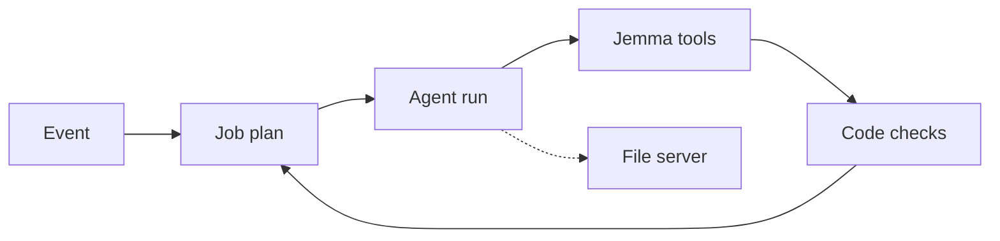

# Jemma architecture

## Agent shape

An event starts a job plan. Code builds the plan from the database after every step. Each of the 9 AI jobs is one run. Goose, Claude Code on the owner's laptop and the operator runner call Jemma's tools over MCP. The hosted app's own runner calls the same functions in code, and its model gets no tools. Save tools enforce the rules in code: marks, sources, school scope, and banned words for Long view patterns only. Code then checks what the event had to produce, retries, falls back to another model, or hands the item to the teacher.

## MCP servers

| | Server | What it does here |
| --- | --- | --- |
| Built | Jemma's own, 27 tools (`packages/profiling/src/tools/registry.ts`) | Reads records. Saves marks, profile updates, reports, lessons, guidance and Long view drafts. |
| Borrowed | The official filesystem server, pinned 2.2.0 | Lets goose write a Markdown copy of a report into one folder. |

Why borrowed: sandboxed, allow-listed file access with path-escape protection is security code we should not write and audit ourselves.

## Models

Open weights (`packages/runner/src/goose.ts`): `nvidia/nemotron-3.5-super-vl`, `nvidia/nemotron-3.5-lightning`, `nvidia/nemotron-3-ultra-550b-a55b`, `google/gemma-4-31b-it`. They run on OpenRouter's free tier, nothing local. Claude Code is the frontier model alongside (`pnpm operator`); the operator can also drive goose, proven live on seven jobs.

## Where a person decides

Each is a tap by a named teacher. The change is made first, then the name and time go to `approvals`. If that write fails, the tap stands and a log line says so. Past records are refused without it.

- Topic map: Approve map.
- Answer key: Approve key.
- Unsure marks: the teacher checks the paper.
- Guardian link: the teacher says yes.
- Past records: Add to records.
- Sharing results: Share with parents, once per test.
- Long view pattern: Looks right.
- The talk: We have talked. Only then does a parent see it. The learner never does.

## What is logged

Every tool call, with input, output, time and duration, in `tool_calls`. Calls to the borrowed server are logged too, with the engine, model, tokens and cost. Approvals carry the person's name. Teachers read both on "The full log" screen. Parents and learners cannot. Plain writes, not tool calls: notifications, event status, a failed read's Needs you item.

## Cost per run

Free tier: $0 (33 of 33 eval runs, `EVALS.md`). Paid price: about $0.02 a run, median 70,797 tokens in and 4,152 out.

Detail: `docs/architecture.md`.
