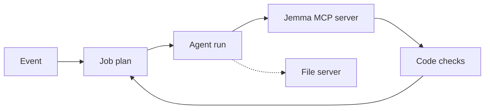

# Jemma architecture

## Agent shape

An event (a photo, a note, a finished lesson, shared results) starts a job plan. Code builds the plan from the database after every step. Each of the 9 AI jobs is one run: goose on an open-weights model, Claude Code on the owner's laptop, or the hosted app's own runner. The run reads through Jemma's tools and must finish through a save tool. Save tools enforce the rules in code: marks, sources, banned words, school scope. Code then checks what the event had to produce, retries, falls back to another model, or hands the item to the teacher.

## MCP servers

| | Server | What it does here |
| --- | --- | --- |
| Built | Jemma's own, 27 tools (`packages/profiling/src/tools/registry.ts`) | Read a learner's records, mark a paper, save a profile update, class report, lesson, guidance card or Long view draft. |
| Borrowed | The official filesystem server, pinned 2.2.0 | Lets goose write a Markdown copy of a report into one folder. |

Why borrowed: sandboxed, allow-listed file access with path-escape protection is security code we should not write and audit ourselves.

## Models

Open weights, in order (`packages/runner/src/goose.ts`): `nvidia/nemotron-3.5-super-vl`, then `nvidia/nemotron-3.5-lightning`, `nvidia/nemotron-3-ultra-550b-a55b` and `google/gemma-4-31b-it`. They run in the cloud on OpenRouter's free tier, nothing local. The cards name OpenMDW-1.1 and Apache-2.0. Claude Code is the frontier model alongside, through the operator runner (`pnpm operator`). The same runner can drive goose (`JEMMA_RUNNER_AGENT=goose`), proven live on seven jobs.

## Where a person decides

Each is a tap by a named teacher, saved in `approvals` with the name and the time:

- Topic map: Approve map.
- Answer key: Approve key.
- Unsure marks: the teacher checks the paper.
- Guardian link: the teacher says yes.
- Sharing results: Share with parents, once per test (also `tests.shared_by`).
- Long view pattern: Looks right (also `long_view_patterns.approved_by_name`).
- The talk: We have talked. Only then does the parent see the pattern (`discussed_by_name`). The learner never does.

## What is logged

Every tool call, with input, output, time and duration, in `tool_calls`. Calls to the borrowed server are logged too, with the engine, model, tokens and cost. Approvals carry the person's name. Teachers read both on "The full log" screen. Parents and learners cannot.

## Cost per run

Free tier: $0 (33 of 33 eval runs). At the listed paid price, about $0.02 a run (from $0.0084 to $0.07), for a median of 70,797 tokens in and 4,152 out. See `EVALS.md`.

Detail: `docs/architecture.md`.
