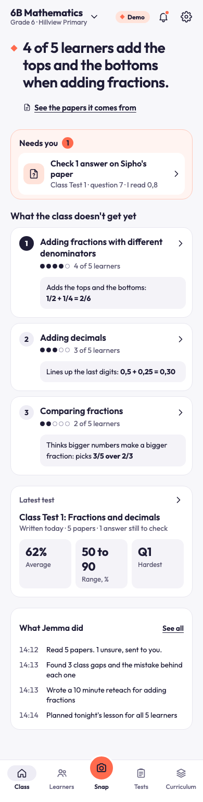
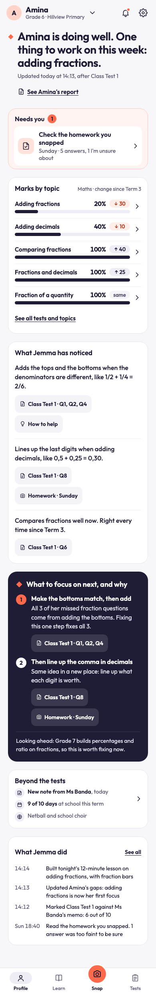
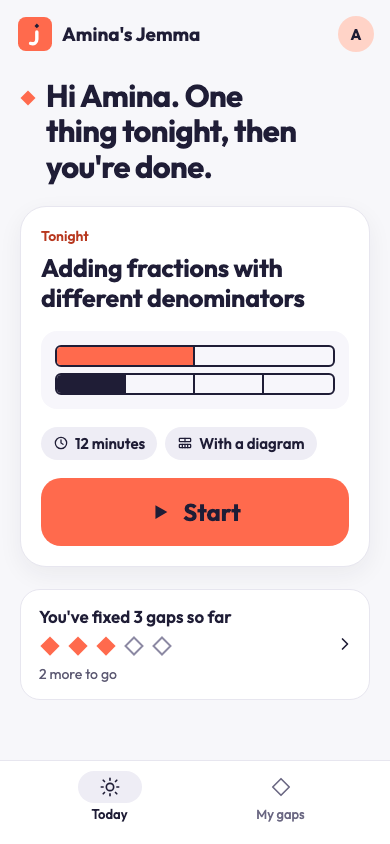
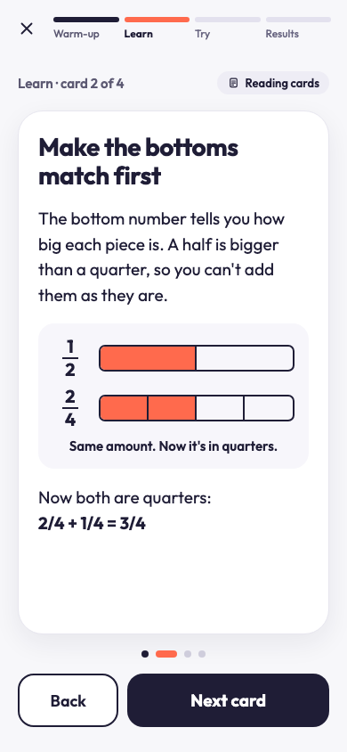

# Jemma

Each school child's own AI tutor. The teacher feeds it, the parent teaches with it, and the child fills their own gaps.

- **The teacher feeds Jemma.** They upload the curriculum and photograph a class test. Jemma marks every paper, finds what each child gets wrong and why, and tells the teacher what to reteach.
- **The parent teaches at home.** Jemma plans a short lesson for each child's biggest gap. The parent hands the phone over for the session and sees the result.
- **The child fills their own gaps.** The child runs the lesson (reading cards, a diagram or a short audio memo), answers a few questions, and never sees a score.

Jemma keeps a learner profile over time: marks by topic, gaps and their stage, sessions, teacher notes, attendance, activities and a subject guidance card. Jemma has its own MCP server, and every piece of AI work goes through its tools.

Built for the Agentic Africa Challenge, learner profiling track. Licence: to be announced.

## The agent loop

1. **Curriculum.** The teacher uploads the curriculum. Jemma drafts a topic map. The teacher approves it.
2. **Snap.** The teacher photographs the memo and then each child's paper.
3. **Mark.** A model reads the photo. Code marks the answers against the key. Anything unsure goes to the teacher's Needs you list.
4. **Find gaps.** Jemma works out why each wrong answer is wrong, opens a gap for each child, and writes a class report with a reteach plan.
5. **Lesson.** Jemma plans the next session from the child's profile and writes the lesson in the format that has worked best for that child.
6. **Result.** The child finishes the session. Jemma updates the gap (new, practising, fixed), plans the next lesson, and the teacher and parent see the result.

## Screens

Design reference images from `design/reference/` (rendered from the v1 design boards). Final screenshots will replace these.

| Teacher: class home | Parent: profile | Child: today | Child: lesson |
| --- | --- | --- | --- |
|  |  |  |  |

## Try the live demo

The live link is to be announced with the submission: `<live link>`.

1. Open `/demo`. You get your own copy of Hillview Primary, a made-up school. Nothing you do reaches other judges.
2. Pick a person: **Ms Banda** (teacher), **Thandi M** (parent, Amina's mother) or **Amina** (a Grade 6 learner). Ms Banda is the place to start.
3. Follow the five steps on the page: approve the topic map, snap the memo and five papers (sample papers are there if you have none), link Amina with the class code, run tonight's session as Amina, then see the result as Ms Banda and Thandi.
4. Use **Reset demo** to put your copy back to step 1. It takes about 10 seconds.

More detail is in [docs/judges.md](docs/judges.md). Every person and paper is made up.

## Run it locally

You need a current Node (built and tested on Node 26), pnpm 10.27.0 (the repo pins it in `package.json`), and a Supabase project of your own with the migrations in `supabase/migrations` applied.

```bash
pnpm install
cp .env.example .env.local          # then fill in the values (see below)
cp .env.local apps/agent/.dev.vars  # the agent worker reads this file, not your shell
```

Env vars that matter (all in `.env.example`, with a comment for each):

| Var | What it is |
| --- | --- |
| `SUPABASE_URL`, `SUPABASE_ANON_KEY`, `SUPABASE_SERVICE_ROLE_KEY` | Your Supabase project. The service key is for the server and agent only. |
| `AGENT_URL`, `EVENTS_SECRET` | Where the web app posts events (`http://localhost:8787` locally) and the shared secret. |
| `CHILD_PIN_PEPPER` | Server-side pepper for child PINs. |
| `LLM_PROVIDER`, `LLM_MODEL`, `VISION_PROVIDER`, `VISION_MODEL` | The text and photo models. Use free ones. |
| `OPENROUTER_API_KEY` | Key for the free models. |
| `AI_MODE` | `live`, `record`, `replay` or `cache`. See below. |

Start the two servers in two terminals:

```bash
pnpm --filter agent dev    # agent worker on http://localhost:8787 (wrangler dev)
pnpm --filter web dev      # web app on http://localhost:3000
```

Then open `http://localhost:3000/demo`. The agent also needs a Cloudflare connection once for the Workers AI binding: run `pnpm --filter agent exec wrangler login` if `wrangler dev` cannot reach Cloudflare. Without it, audio lessons are saved with no audio and the player uses browser speech. The first start can take about a minute while it connects. Check it with `curl http://localhost:8787/health`, which answers `{"ok":true}`.

Run the checks:

```bash
pnpm test         # vitest, all packages (needs the Supabase env: several tests use a real project)
pnpm typecheck    # tsc in every package
```

### AI_MODE

Every model call goes through a replay layer, controlled by `AI_MODE` in `apps/agent/.dev.vars`:

- `live`: call the model.
- `record`: call the model and store the answer in the `ai_replays` table.
- `replay`: use only stored answers. A missing one is an error. No model is called.
- `cache`: use a stored answer if there is one, otherwise call the model and store it.

Tests never call a live model. Free models are slow and fail often, so the judges' deployment runs in `cache` after one warm-up run. A fresh Supabase project has no stored answers, so `replay` fails until you have run once in `record` or `cache`. Steps for recording and for the browser demo-path test are in [docs/runbook.md](docs/runbook.md). Stop every dev server you start.

### Connect an MCP client

The agent serves MCP at `/mcp` and needs a bearer token. See [docs/mcp-server.md](docs/mcp-server.md).

## Repo map

| Path | What is in it |
| --- | --- |
| `apps/web` | The web app: Next.js on Cloudflare Workers (OpenNext). Teacher `/t`, parent `/p`, learner `/k`, and `/demo`. |
| `apps/agent` | The agent worker: `/events`, `/mcp`, `/health`, the Queue consumer and the cron. |
| `packages/profiling` | The MCP tools, zod schemas, job prompts, learning logic, model layer, orchestrator. |
| `packages/runner` and `apps/desktop` | Jemma Desktop runs jobs on the user's Claude Code or Codex subscription; pair it by entering the six-character code shown in the signed-in Jemma web app, and build the unsigned Mac app with `CSC_IDENTITY_AUTO_DISCOVERY=false pnpm --filter desktop dist`. |
| `supabase/migrations` | Database schema, row-level security, functions. |
| `supabase/seed` | The made-up school, the demo sandboxes and the sample papers. |
| `fixtures` | Synthetic papers and the sample curriculum. |
| `design` | The v1 design boards (`v1-screens`), reference and actual screenshots. |
| `docs` | Documentation, the spec, the plan and the runbook. |

## Documentation

- [docs/architecture.md](docs/architecture.md): components, event flow, data model, privacy rules.
- [docs/mcp-server.md](docs/mcp-server.md): how to connect, every tool with its schema, an example session.
- [docs/judges.md](docs/judges.md): the 5-minute path, demo accounts, known limits.
- [docs/submission-description.md](docs/submission-description.md): the text description for the entry form.
- [docs/runbook.md](docs/runbook.md): running, recording AI answers, resetting a demo.
- [docs/superpowers/specs/2026-10-26-jemma-v1-design.md](docs/superpowers/specs/2026-10-26-jemma-v1-design.md): the v1 design spec.

## Rules for contributors

- Synthetic learner data only. No real learner information in this repo.
- No em dashes in any copy, code or docs. A test checks this.
- The licence is not chosen yet. Do not add a licence file.
