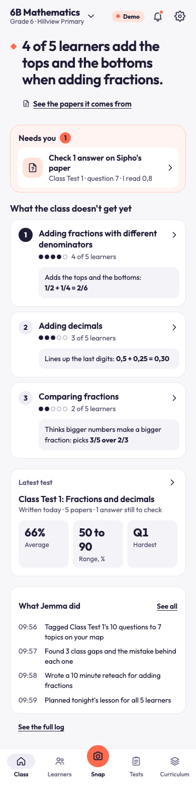
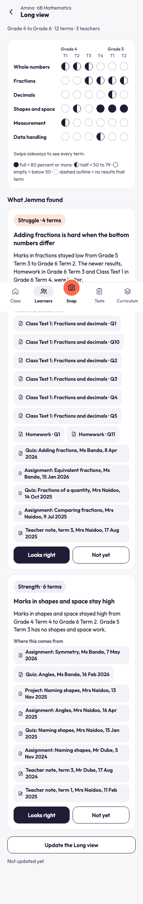
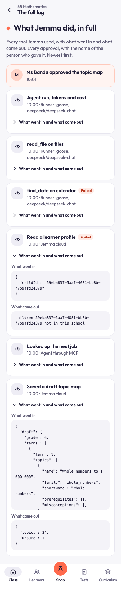
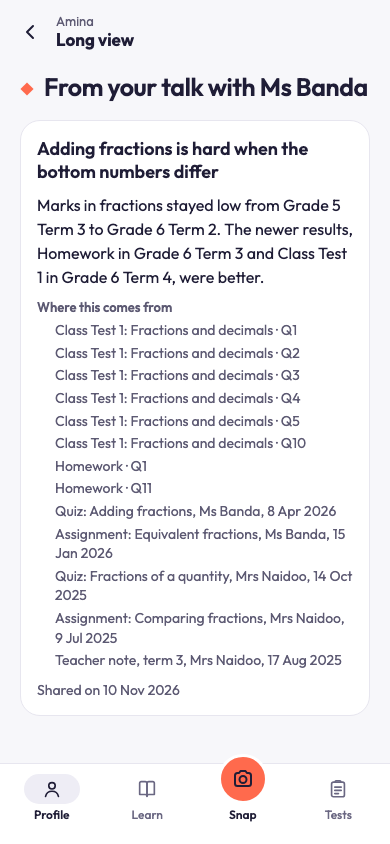

# Jemma

[](https://github.com/AI-Native-Ventures/jemma/actions/workflows/ci.yml)

Jemma follows one learner across years, not one term. It marks each class test, keeps a sourced record for every child, and shows the teacher what held for three terms or more, so the teacher can raise it with the family. It builds a profile, never a label: nothing about a child reaches a parent until the teacher has checked it and talked to the family.

Built for the African Agentic AI Design Challenge, Education track (The Long View), sub-theme Longitudinal strength tracking. Licence: MIT. Live demo: https://jemma-web.horizonsystems.workers.dev/demo.

## The rules it keeps

- **A profile, not a label.** Jemma surfaces a pattern ("fractions stayed low from Grade 5 Term 3 to Grade 6 Term 2"). It never assigns a track, a subject path or a career.
- **Every claim has a source.** A pattern lists the quizzes, tests and teacher notes it comes from, and a teacher can open each one. The save tool drops a pattern that matches no record.
- **The teacher goes first.** Every gate is a tap by a named teacher: the topic map, the answer key, a mark Jemma is unsure about, a guardian link, sharing results, adding a file of past records, a Long view pattern, and the talk with the guardian. The name and the time are kept.
- **Never ranked.** A learner is not compared with classmates and never sees the Long view or a score.
- **Marks are code.** A model reads a photo. Code marks it.
- **Synthetic data only.** No real learner is in the system.

## Run it

```bash
./start.sh
```

That one command sets everything up and starts Jemma on your machine, with made-up data and recorded AI answers. No keys, no accounts and no AI model are needed.

You need three things:

1. **Docker**, running. It holds the local database and file storage.
2. **Node 22 or newer.** pnpm comes with it (the script uses corepack if you do not have pnpm).
3. **About 10 minutes and a few GB of disk the first time**, to download the Supabase images. Later starts reuse them.

If something is missing, the script stops at the first step and says exactly what to get.

What you will see: six numbered steps, each with one plain line (check what you need, install the packages, start the local database, write the settings, load the recorded AI answers, start the agent and the web app). When both servers answer, it prints:

```
Jemma is running. Open http://localhost:3000/demo
```

Open that page and follow the tour below. You get your own copy of the made-up school Hillview Primary.

How it works on your machine: the local database is Supabase in Docker (`supabase/config.toml`, with the migrations in `supabase/migrations`). Jemma runs with `AI_MODE=replay`, so every model call is answered from `fixtures/ai-replays.json.gz`, 167 recorded answers made earlier with free models. The agent worker runs from `apps/agent/wrangler.local.jsonc`, which has no Cloudflare speech binding, so lessons are saved with no audio and the player uses browser speech. Jemma only knows the answers recorded for the demo path: the sample curriculum, the five sample papers, the sessions that follow and the Long view updates (one for each learner who has a pattern, Amina's again after the teacher's note, and three made-up learners: Neo, Lindiwe and Mpho). Something new, such as your own photo, has no recorded answer and the job shows an error.

To stop:

- **Ctrl-C** stops the web app and the agent. The database keeps running, so the next `./start.sh` reuses it.
- **`./start.sh --stop`** stops the app and the database.
- **`./start.sh --force`** writes a fresh `.env.local`. Without it, the script never overwrites an existing `.env.local`: if yours points anywhere but the local database, it stops and tells you.

Logs are in `.jemma/logs/` (`install.log`, `supabase.log`, `replays.log`, `agent.log`, `web.log`). `./start.sh --ci` does the same set-up with the app in the background and exits when both servers answer. GitHub Actions uses it to check, on a clean machine, that the repo runs (see the badge at the top).

## A one minute tour

Open `/demo` (on your machine, or on the live demo). Pick **Ms Banda** (teacher), **Thandi M** (parent, Amina's mother) or **Amina** (a Grade 6 learner). Start with Ms Banda. The page lists the steps, and [docs/judges.md](docs/judges.md) walks through them in about 5 minutes.

1. **Approve the topic map.** Jemma drafts it from the sample curriculum. The teacher approves it.
2. **Snap the memo and five papers.** Jemma reads each photo and code marks it. Anything unsure goes to Needs you. The results stay hidden from the family until the teacher taps **Share with parents**.
3. **Link a parent and run a lesson.** Thandi links Amina with the class code and the teacher says yes. Amina runs tonight's session and never sees a score.
4. **Open the Long view.** As Ms Banda, open Amina's Long view: her marks by strand across school years, and the patterns found in them. Open one source, tap **Looks right**, then **We have talked**. Thandi now sees it on Amina's profile. Amina sees nothing.
5. **Read the full log.** On the class home, "See the full log" lists every tool call with what went in and what came out, and every approval with the name of the person who gave it.

| Teacher: class home | Teacher: Long view | Teacher: the full log | Parent: after the talk |
| --- | --- | --- | --- |
|  |  |  |  |

These are screenshots from the running app at 390 px, taken by the builders of each screen. The Share with parents card is in `design/proof/p50b/class-home-card-390.png`.

## How the agent works

1. An event (a photo, a note, a finished lesson, shared results) starts a job plan that code builds from the database after every step.
2. Each AI job is one run: goose on an open-weights model, Claude Code on the owner's laptop, or the hosted app's own runner. It reads through Jemma's own MCP server (25 tools).
3. The run must finish through a save tool. Save tools enforce the rules in code: marks, sources, banned words, school scope.
4. Code checks that the event produced what it had to, retries, falls back to another model, or hands the item to the teacher.
5. A person decides at every gate, and every tool call and approval is logged and readable on the full log screen.

One page: [ARCHITECTURE.md](ARCHITECTURE.md). The long version: [docs/architecture.md](docs/architecture.md).

## Run the agent on an open-weights model yourself

Goose (open source, Apache-2.0) drives a free open-weights model on OpenRouter through Jemma's MCP server and one borrowed MCP server, the official filesystem server. It needs:

- Goose installed (https://github.com/block/goose). It was run with version 1.45.0.
- A free OpenRouter key as `OPENROUTER_API_KEY` in `.env.local`.
- The database values in `.env.local` (`./start.sh` writes them for a local database).
- Nothing running on port 8756: the command starts its own agent worker there and stops it.

```bash
pnpm evals --task class-report --runs 1 --cap 100
```

`--cap` is needed because the repository's ledger (`evals/results/ledger.jsonl`) already counts 51 live goose runs (42 behind the main set of EVALS.md and 9 on Gemma that the provider refused) against the default cap of 45. The command makes a fresh made-up school, sends a real `class_report` event, runs the job through goose on `nvidia/nemotron-3.5-super-vl:free` (the next model in the list takes over if it fails), and checks the outcome in code. It prints `PASS` or `FAIL` with the seconds, and saves the checks and goose's full stream in `evals/results/<run id>/`. The saved runs in this repository used the team's dev database. The local one was not tried.

The open-job script (`pnpm --filter @jemma/runner open-job --runs 1 --live-used 0 --out <a folder>`) does the same for one `class_report` and also copies the Markdown report the model wrote into the folder. It needs an agent worker on port 8749 (`pnpm --filter agent exec wrangler dev --port 8749 --var AI_MODE:replay --show-interactive-dev-session=false`), and it refuses every database but the local one and the project named in `JEMMA_ALLOWED_SUPABASE_REF` (its built-in default is the team's earlier dev project, which is no longer in use), so it is not a path for a stranger. The proof of it is [docs/proof/open-runner-2026-11-10.md](docs/proof/open-runner-2026-11-10.md).

## Swap the harness or the model

Two things can change: the harness (what runs the agent) and the model (what thinks). Claude Code is the frontier model alongside, which the rules page allows. Goose with an open-weights model is the path the evals prove.

**The model, in the goose runner.** `packages/runner/src/goose.ts` reads these:

| Setting | What it does |
| --- | --- |
| `JEMMA_OPEN_MODEL` | The first model to try. Default `nvidia/nemotron-3.5-super-vl:free`. Any OpenRouter model id. |
| `JEMMA_OPEN_MODEL_FALLBACKS` | Comma list tried in order if the first fails before anything was saved. Default `nvidia/nemotron-3.5-lightning:free,nvidia/nemotron-3-ultra-550b-a55b:free,google/gemma-4-31b-it:free`. |
| `OPENROUTER_API_KEY` | The key goose uses. |
| `JEMMA_REPORTS_DIR` | The one folder the borrowed file server may write. Default `<home>/Jemma/reports`. |

For example: `JEMMA_OPEN_MODEL=google/gemma-4-31b-it:free pnpm evals --task class-report --runs 1 --cap 100`. The 33-run set in the evals used the default list. Gemma 4 alone was tried on one task, `class-report`, in three folders of 3 runs (the 31B twice, the 26B A4B once, on 11 November). The free provider gave no answer to any of the 9 runs ("high demand", then "Rate limit exceeded"), so no Gemma run was judged and there is no Gemma pass or fail (the section "A second open-weights model on one task" in [EVALS.md](EVALS.md)). The Hugging Face cards of the four default models name OpenMDW-1.1 (the three Nemotron models) and Apache-2.0 (Gemma 4); the links and the date are in [docs/compliance.md](docs/compliance.md).

**The model, in the hosted app's own runner.** Set these in `apps/agent/.dev.vars` (see [docs/runbook.md](docs/runbook.md)) and restart `pnpm --filter agent dev`: `LLM_PROVIDER`, `LLM_MODEL` and `LLM_MODEL_FALLBACKS` for text, `VISION_PROVIDER`, `VISION_MODEL` and `VISION_MODEL_FALLBACKS` for photos. The providers are `deepseek`, `openrouter`, `anthropic`, `google`, `openai` and `opencode` (`packages/profiling/src/ai/models.ts`). Recorded answers are keyed by model id, so a new id has none: use `AI_MODE=cache` or `AI_MODE=live` with a key.

**The harness.** `packages/runner/src/agents.ts` lists three engines: `claude`, `codex` and `goose`. The operator runner picks one with `JEMMA_RUNNER_AGENT`, for example `JEMMA_RUNNER_AGENT=codex pnpm operator`. The default is `claude`, run live in the operator proof ([docs/proof/operator-path-2026-11-10.md](docs/proof/operator-path-2026-11-10.md)). `JEMMA_RUNNER_AGENT=goose pnpm operator` starts the operator with goose and the open-weights model list above. It needs `OPENROUTER_API_KEY` in `.env.local` (the operator keeps that one key for goose and removes it for Claude Code and Codex), and it takes the models from `JEMMA_OPEN_MODEL` and `JEMMA_OPEN_MODEL_FALLBACKS` in `.env.local` or the shell. It was run live on a local agent worker: 12 agent runs, all done, covering seven of the eight AI job kinds (everything but `draft_map`), with the default free models ([docs/proof/operator-goose-2026-11-11.md](docs/proof/operator-goose-2026-11-11.md)). Goose is also driven by the scripts above. The agent worker needs `AI_ROUTE=operator` for the operator to get any work.

## Evals

Eleven tasks, each run three times on a free open-weights model through goose, with plain code judging every outcome and no model as a judge. All 33 runs passed. The weakest task is `other-school-id` (median 472 s, and one run ended on the 600 s limit while the model kept retrying refused calls). The numbers, the cost per run and what to try next are in [EVALS.md](EVALS.md).

## Run against your own Supabase project

Use this if you want a hosted Supabase project instead of the local database. You need Node 22 or newer (built and tested on Node 26), pnpm 10.27.0 (the repo pins it in `package.json`), and a Supabase project of your own with the migrations in `supabase/migrations` applied.

Set up a fresh project in this order:

1. **The migrations.** Apply every file in `supabase/migrations` in order (0001 to 0023), for example with `psql` and the project's connection string (`SUPABASE_DB_URL` in `.env.example`) on each file in turn. The migrations also make the five private storage buckets.
2. **The sign-in settings.** Set the site address to the address of your web app and add that address to the allowed redirect addresses. Turn email confirmation off: the demo makes its own users and signs them in with a password, and sends no email. The local values are in `supabase/config.toml` (`[auth]` and `[auth.email]`).
3. **The settings of the app.** Fill in `.env.local` and copy it to `apps/agent/.dev.vars`, as below.
4. **The recorded answers.** Load them with the script named below, before you use `AI_MODE=replay`.
5. **The sample sheets.** They come from the app itself: the first demo copy puts the memo and the five papers in the `sample-papers` bucket.

```bash
pnpm install
cp .env.example .env.local          # then fill in the values (see below)
cp .env.local apps/agent/.dev.vars  # the agent worker reads this file, not your shell
```

Env vars that matter (all in `.env.example`, with a comment for each):

| Var | What it is |
| --- | --- |
| `SUPABASE_URL`, `SUPABASE_ANON_KEY`, `SUPABASE_SERVICE_ROLE_KEY` | Your Supabase project. The service key is for the server and agent only. |
| `AGENT_URL`, `EVENTS_SECRET` | Where the web app posts events (`http://localhost:8787` locally) and the shared secret. |
| `CHILD_PIN_PEPPER` | Server-side pepper for child PINs. |
| `LLM_PROVIDER`, `LLM_MODEL`, `VISION_PROVIDER`, `VISION_MODEL` | The text and photo models. Use free ones. |
| `OPENROUTER_API_KEY` | Key for the free models. |
| `AI_MODE` | `live`, `record`, `replay` or `cache`. See below. |
| `JEMMA_ALLOWED_SUPABASE_REF` | The project ref the maintenance scripts may run against, besides the local database. |

Start the two servers in two terminals:

```bash
pnpm --filter agent dev    # agent worker on http://localhost:8787 (wrangler dev)
pnpm --filter web dev      # web app on http://localhost:3000
```

Then open `http://localhost:3000/demo`. `pnpm --filter agent dev` also needs a Cloudflare connection once for the Workers AI binding: run `pnpm --filter agent exec wrangler login` if `wrangler dev` cannot reach Cloudflare. If you have no Cloudflare login, use `pnpm --filter agent dev:local` instead: it runs the same agent without the speech binding. Without speech, audio lessons are saved with no audio and the player uses browser speech. The first start can take about a minute while it connects. Check it with `curl http://localhost:8787/health`, which answers `{"ok":true}`.

To load the recorded answers into your own project (needed for `AI_MODE=replay`), run `pnpm --filter @jemma/profiling exec tsx ../../scripts/load-replays.ts`.

Run the checks:

```bash
pnpm test         # vitest, all packages (needs the Supabase env: several tests use a real database, the local one from ./start.sh is fine)
pnpm typecheck    # tsc in every package
```

Run `pnpm test` and the browser specs against the local database only (`./start.sh`, and CI does the same), never against a small hosted project. On 13 November 2026 two days of test runs against the free project behind the live demo used up the CPU allowance of its machine, and the demo could not start for about three hours.

### AI_MODE

Every model call goes through a replay layer, controlled by `AI_MODE` in `apps/agent/.dev.vars`:

- `live`: call the model.
- `record`: call the model and store the answer in the `ai_replays` table.
- `replay`: use only stored answers. A missing one is an error. No model is called.
- `cache`: use a stored answer if there is one, otherwise call the model and store it.

Tests never call a live model. Free models are slow and fail often, so the judges' deployment runs in `cache` after one warm-up run. `./start.sh` runs in `replay` and loads the recorded answers for you. A fresh Supabase project of your own has no stored answers, so `replay` fails until you have loaded them (see above) or run once in `record` or `cache`. Steps for recording and for the browser demo-path test are in [docs/runbook.md](docs/runbook.md). Stop every dev server you start.

### Connect an MCP client

The agent serves MCP at `/mcp` and needs a bearer token. See [docs/mcp-server.md](docs/mcp-server.md).

## What is not finished

- **No real teacher and no real learner has used Jemma.** The school, the people and the records are made up.
- **Mathematics only.** The demo school has four Mathematics classes, in Grades 4 to 7, and the class form offers Grades 1 to 12. Only 6B has hand-made history; the learners of the other classes are made up by code. Other subjects are not offered yet, and the only reads of another subject by a model were three curriculum documents (EVALS.md, "Outside Mathematics": 3 of 3, 0 of 3 and 0 of 2 judged runs passed).
- **Not built yet:** Grade 8 to 12 question types, teen invites, chat, billing, offline mode and messages between teacher and parent. Also not built: deleting or downloading a family's data, deleting an account, moving a class up or archiving it at the end of the year, starting from another teacher's map, adding a second teacher's code, and a sign-up for a Grade 8 to 12 learner. Screens that link to them say "Coming after the challenge".
- **No live in-browser camera for teachers.** Teachers snap with the phone's own camera, one photo per page.
- **No email, SMS or WhatsApp.** Jemma only shows notifications inside the app. Email sign-in is not part of the demo path and was not tested against a real inbox. Use the demo page.
- **Free models are slow and fail often.** A full run of the demo path with no recorded answers took about 15 to 25 minutes when it was recorded. If you upload something new, that call goes to a free model and can take minutes or fail. One model call gets 4 minutes, then the next model in the list is tried. A job that shows no sign of life for 16 minutes is put back on the queue, twice at most, then marked failed. A first read of something new took between 15 and 90 seconds on the days it was measured. `./start.sh` avoids this by using recorded answers only, so it cannot handle new input.
- **The free hosted database ran out on 13 November 2026.** The hosted demo runs on a free Supabase project. It could not start for about three hours, because two days of test runs against it had used up the CPU allowance of its machine. It was moved to a fresh project the same day. The rule since then: run the tests and the browser specs on a local database only.
- **Privacy inside one school.** A teacher can add a learner who is in another teacher's class of the same school to their own class (Class settings, "Add a learner", under "Already at your school"). Nobody is asked: not the other teacher, not the family. The learner stays in the other class too. From then on the teacher can read that learner's marks, records, notes and Long view. A class of the school that the teacher can already see can also be copied into a new class. Only learners of the same school can be added, and a teacher of another school can read nothing. This is left as it is on purpose and listed here.
- **Laptop runners send learner data to that laptop.** When a job runs on the owner's laptop (goose, Claude Code or Jemma Desktop), the prompt and the tool results, with learner data in them, reach that machine and the model it uses.
- **Uploads.** A photo over 1 MB is made smaller in the browser (its longest side at most 2000 px) before it is sent. A PDF is sent whole. The curriculum screen takes a PDF, a JPG or a PNG of at most 10 MB and 40 pages for each document, and 30 MB for one upload.
- **Curriculum PDFs are read by the cloud model only.** The topic map job is never handed to the owner's laptop, because Claude Code cannot read a PDF that comes back through MCP, and it was never run on goose.
- **The Long view was opened on the deployed demo** on 11, 12 and 13 November 2026, at 390 px and 1440 px, with patterns, their sources and the teacher's two buttons. Its logic and tools are covered by tests, and no real teacher has used it.
- **The Share with parents card** has its own browser spec (`apps/web/e2e/p50b.spec.ts`), which ran on 11 November (4 of 4: its two tests on a phone and on a laptop), with screenshots in `design/proof/p50b`. The demo-path test also uses the card, and passes on a clean machine in CI.
- **Three browser specs written on 13 November were never run:** `apps/web/e2e/p75.spec.ts` (big photos), `apps/web/e2e/p77.spec.ts` (failed reads) and the time zone test in `apps/web/e2e/p73.spec.ts`. The hosted database could not serve them that day.
- **Failed reads were seen on the deployed demo in one place only:** the memo card ("Jemma could not read the memo.") and its "Try the same photo again". A failed paper on the papers screen, the Needs you item that opens that screen, the parent's screen for a photo that could not be read, and a real model call that times out and goes to the next model are covered by unit tests only.
- **A stuck job being put back on the queue was seen once**, on the earlier hosted database, where it moved old test leftovers. It has not been seen since.
- **No photo from a real phone camera, no rotated photo, no real teacher and no real learner.** The big photos were made on a computer from the sample sheets: a 1.5 MB memo photo was stored as 187 KB at 2000 px, and a 1.6 MB paper photo as 204 KB and was read and marked in 32 seconds.
- **The evals ran task by task, never as the single `pnpm evals` command in one go, and never against the local database.** The photo task reads a rendered paper, not a photo from a phone. One failure was not fixed: `other-school-id` waits up to ten minutes before it gives up (see EVALS.md).
- **A curriculum Jemma had never seen passed 7 of 9 judged runs.** On three invented Mathematics documents read live on the free models (EVALS.md, "A curriculum Jemma had never seen"), Grade 9 South Africa passed 3 of 3, the Grade 4 Kenya scan 3 of 3 and Grade 5 South Africa 1 of 3: in both fails the model named the topic that the plan lists in two terms differently in the later term, so the question that code adds for a topic with the same name in two terms did not fire. The text-reading fallback was never needed live, so only tests cover it. On 13 November 2026 curriculum documents were also read on the deployed demo: the Grade 5 South Africa plan and the Grade 4 Kenya scan, then the Grade 9 South Africa plan, uploaded, read, its questions answered and approved at 08:12, and a 5 MB PDF read in 68 seconds. Those tries are not scored runs and are not in EVALS.md.
- **The operator route is switched off on the hosted demo.** It was proven on a local agent worker, in separate runs, never as the whole demo path in one run.
- **The Mac desktop app is unverified.** It is in `apps/desktop`, was not run for this submission, and does not offer goose.
- **No spoken lessons in the one-command run.** Speech needs a Cloudflare connection, so the player uses browser speech.
- **Phones and laptops only.** Built and checked at 390 px (phone) and 1440 px (laptop). Light theme only.

More detail is in [docs/architecture.md](docs/architecture.md) (what is not built) and [docs/judges.md](docs/judges.md) (known limits). Where each entry rule is met, and where it is not, is in [docs/compliance.md](docs/compliance.md).

## Repo map

| Path | What is in it |
| --- | --- |
| `apps/web` | The web app: Next.js on Cloudflare Workers (OpenNext). Teacher `/t`, parent `/p`, learner `/k`, and `/demo`. |
| `apps/agent` | The agent worker: `/events`, `/mcp`, `/health`, the Queue consumer and the cron. |
| `packages/profiling` | The MCP tools, zod schemas, job prompts, learning logic, model layer, orchestrator. |
| `packages/runner` and `apps/desktop` | The runners: Jemma Desktop (the user's Claude Code or Codex; pair it by entering the six-character code shown in the signed-in Jemma web app; build the unsigned Mac app with `CSC_IDENTITY_AUTO_DISCOVERY=false pnpm --filter desktop dist`), the goose runner, and the operator runner (`pnpm operator`). |
| `evals` | The eval harness, its eleven tasks and the saved results behind `EVALS.md`. |
| `supabase/migrations` | Database schema, row-level security, functions. |
| `supabase/seed` | The made-up school, the demo sandboxes and the sample papers. |
| `fixtures` | Synthetic papers, the sample curriculum and the recorded AI answers. |
| `design` | The v1 design boards (`v1-screens`), reference and actual screenshots (`design/proof`). |
| `docs` | Documentation, the spec, the plan and the runbook. |

## Documentation

- [ARCHITECTURE.md](ARCHITECTURE.md): the one-page design.
- [EVALS.md](EVALS.md): the eleven eval tasks, their results and the failure that was not fixed.
- [docs/architecture.md](docs/architecture.md): components, event flow, data model, privacy rules.
- [docs/mcp-server.md](docs/mcp-server.md): how to connect, every tool with its schema, an example session.
- [docs/judges.md](docs/judges.md): the 5-minute path, demo accounts, known limits.
- [docs/compliance.md](docs/compliance.md): every rule of the challenge page and where it is met.
- [docs/submission-description.md](docs/submission-description.md): the text description for the entry form.
- [docs/video-shot-list.md](docs/video-shot-list.md): the shot list for the demo video.
- [docs/runbook.md](docs/runbook.md): running, recording AI answers, resetting a demo, evals, the operator runner.
- [docs/superpowers/specs/2026-10-26-jemma-v1-design.md](docs/superpowers/specs/2026-10-26-jemma-v1-design.md): the v1 design spec.

## Built with

Built between 23 October and 15 November 2026 with AI coding tools, as the challenge allows: Claude models (Sonnet 5.5, Opus 5.5 and Fable 5.2, named in the commit trailers) working as coding agents under the owner's direction. At run time Jemma uses open-weights models through goose, free models in the hosted app, and Claude Code on the owner's laptop as the frontier model alongside.

## Rules for contributors

- Synthetic learner data only. No real learner information in this repo.
- No em dashes in any copy, code or docs. A test checks this.
- Jemma is MIT licensed (see `LICENSE`). Keep the licence file and the `license` field in every `package.json`.
