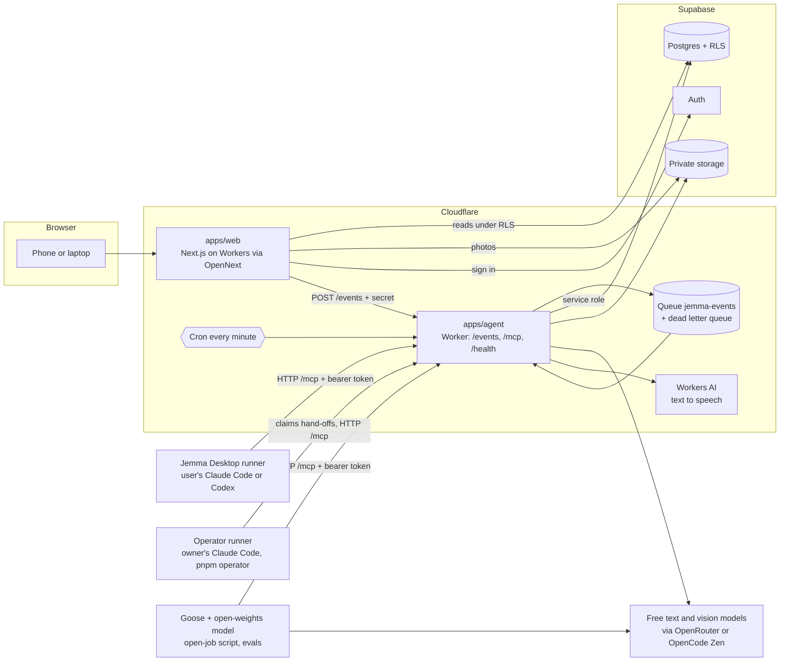
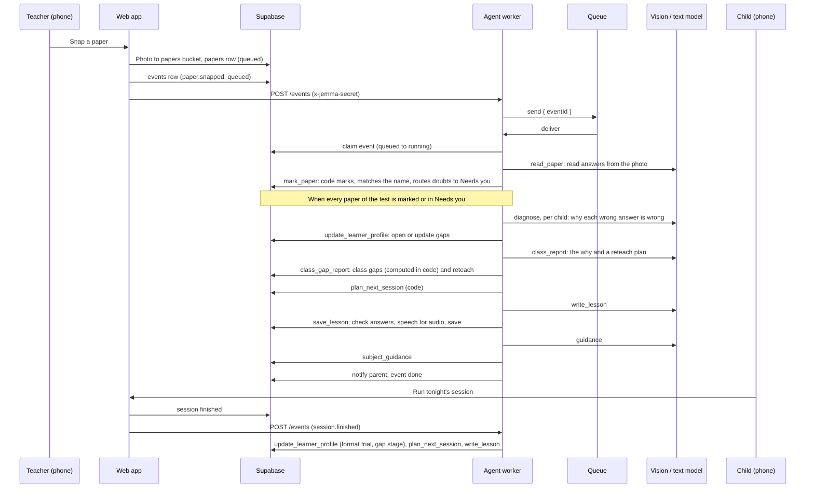

# Jemma architecture

Jemma is a pnpm monorepo. The web app shows every screen. The agent worker does the AI work. Supabase holds the data. The tools are the one door the AI work goes through: over the MCP server for goose, Claude Code and Codex, and as plain function calls for the hosted app's own runner.

Everything in this document was checked against the code. Where a part is not in this repository yet, or was never run, it says so. The one-page version is [ARCHITECTURE.md](../ARCHITECTURE.md).

## Components

| Part | Where | What it does |
| --- | --- | --- |
| Web app | `apps/web` | Next.js 16. Built for Cloudflare Workers with `@opennextjs/cloudflare`. Renders the teacher (`/t`), parent (`/p`) and learner (`/k`) spaces, the `/demo` page and the sign-up and sign-in pages. At `/`, a visitor who is not signed in is sent to the landing site when `LANDING_URL` is set (`apps/web/wrangler.jsonc` sets it for the live app), and otherwise sees a built-in landing page. Reads Supabase under row-level security. It never calls a model. |
| Landing site | `apps/landing` | One static page with its font and ten screenshots, served by Cloudflare as static files with no Worker script, at getjemma.ainative.ventures (the app is at jemma.ainative.ventures; the app's older workers.dev address still answers). It has no form and no script. Its links go to `/demo`, `/sign-in`, `/sign-up`, `/privacy` and `/help` of the app and to the repository. |
| Agent worker | `apps/agent` | A Cloudflare Worker. `/events` takes an event from the web app and puts it on a Queue. The Queue consumer runs the event. `/mcp` serves the MCP server. `/health` answers `{ ok: true }`. A cron every minute checks for a Jemma Desktop runner that has gone quiet, and sends work that was handed to the owner's laptop back to the cloud when that laptop is away. |
| Profiling package | `packages/profiling` | The tools, zod schemas, job prompts, pure learning logic, the model layer and the orchestrator. Both the agent worker and the web app import it. |
| Runner package | `packages/runner` | The core of the Jemma Desktop runner: finds Claude Code or Codex on the machine, claims queued events, runs the agent with the Jemma MCP server, sends heartbeats. The Electron app in `apps/desktop` runs jobs on the user's Claude Code or Codex subscription; pair it by entering the six-character code shown in the signed-in Jemma web app, and build the unsigned Mac app with `CSC_IDENTITY_AUTO_DISCOVERY=false pnpm --filter desktop dist`. |
| Database | `supabase/migrations` | Postgres with row-level security. 27 migration files. |
| Storage | Supabase Storage | Five private buckets: `papers`, `curriculum`, `lesson-audio`, `sample-papers`, `records` (the files of past results a teacher brings in). No public access and no storage policies: files are reached with signed URLs or the service role. |
| MCP server | `packages/profiling/src/server.ts`, served by `apps/agent` | 29 tools. See [mcp-server.md](mcp-server.md). |
| Cloud runner | `apps/agent` + `packages/profiling/src/jobs/cloud` | Runs the 10 AI jobs on free models. |
| Desktop runner | `packages/runner` | Runs the same jobs on the user's own Claude Code or Codex subscription, through `/mcp`. |
| Open runner | `packages/runner/src/goose.ts` | Runs a job with goose (open source) on a free open-weights model, through `/mcp`, plus one borrowed MCP server. |
| Operator runner | `packages/runner/src/operator.ts` | The owner's laptop does the hosted app's AI work with the Claude Code (or Codex) signed in on it, or with goose (`pnpm operator`). |

### The runners

Jemma has 10 AI jobs: `draft_map`, `read_key`, `read_paper`, `diagnose`, `class_report`, `write_lesson`, `guidance`, `long_view`, `map_records`, `read_marked_test`. Each job has a prompt file in `packages/profiling/src/jobs/<job>.md`. Two more steps are plain code and have no prompt: `plan_next_session` and `update_learner_profile`. Four runners can do a job. All of them end in the same save tools.

- **Cloud runner.** For each job the worker calls the read tools in code, asks the model for the save tool's zod object (AI SDK structured output), then calls the save tool. It calls the tool functions directly, in the same process. It does not go through HTTP. Models are picked by `LLM_PROVIDER` and `LLM_MODEL` (text) and `VISION_PROVIDER` and `VISION_MODEL` (photos), with `LLM_MODEL_FALLBACKS` and `VISION_MODEL_FALLBACKS` tried in order. The hosted app puts the paid listing of the open-weights model first and the free ones after it; `cache` and `replay` look a call up under every id of the list before any model is called, so answers recorded under the free ids still hit. Providers wired in `packages/profiling/src/ai/models.ts`: `deepseek`, `openrouter`, `anthropic`, `google`, `openai`, `opencode`. For the cloud runner these are the only places a model id is read.
- **Desktop runner.** A school can be set to `ai_runner = desktop`. The agent leaves its events queued with `runner = desktop`. The desktop runner claims an event (`claim_event`), runs `claude -p` or `codex exec` with the job prompt and the Jemma MCP server, and settles it (`finish_event`). It sends a heartbeat (`heartbeat`) so the cloud knows it is on. If a desktop event waits 10 minutes and the owner has sent no heartbeat in that time, the cron adds one "Jemma Desktop is off" item to the owner's Needs you list. The owner can choose "Run in the cloud this time" (`runInCloud`).
- **Open runner (goose).** `packages/runner/src/goose.ts` and the goose branch of `runJob` in `run.ts`. Goose (open source, Apache-2.0) drives a free open-weights model on OpenRouter and is given two MCP servers: Jemma's own, with a bearer token, and one borrowed, the official filesystem server (`@modelcontextprotocol/server-filesystem`, pinned to 2.2.0, started with `--confine-roots` so it can see only the reports folder). The recipe file is written with mode 0600 and the token is never in a command line. The models are tried in order, each once: `JEMMA_OPEN_MODEL` (default `nvidia/nemotron-3.5-super-vl:free`), then `JEMMA_OPEN_MODEL_FALLBACKS` (default `nvidia/nemotron-3.5-lightning:free`, `nvidia/nemotron-3-ultra-550b-a55b:free`, `google/gemma-4-31b-it:free`). A model is replaced only when its run failed and no Jemma save tool had succeeded, so nothing is saved twice. A run has at most 20 turns and the whole job has one 10 minute limit. Goose runs with its own empty config folder and the keychain switched off. For `class_report` and `guidance` the prompt also asks for a Markdown copy of what was saved, written to the reports folder (`JEMMA_REPORTS_DIR`, default `<home>/Jemma/reports`). After a run the runner sends the calls to the borrowed server, and the model's tokens and cost, to the tool log with `log_external_calls`. Goose is started by the open-job script (`scripts/proof/run-open-job.ts`) and by `pnpm evals`. The Jemma Desktop app does not offer it. The operator runner can also start goose (`JEMMA_RUNNER_AGENT=goose pnpm operator`): its script keeps `OPENROUTER_API_KEY` for goose only, and removes it and every other provider key for Claude Code and Codex. It was run live on a local agent worker on 11 November: 12 agent runs, all done, seven of today's ten AI jobs (not `draft_map`, which is never handed over, and not `map_records` or `read_marked_test`, which were added after the run; the proof counts eight) ([goose operator proof](proof/operator-goose-2026-11-11.md)).
- **Operator runner.** With `AI_ROUTE=operator` on the agent, each AI job first tries the recorded answers (replay). On a miss, when an operator has been seen in the last 90 seconds (it beats every 30 seconds), the event is handed over: `runner = desktop`, `payload.route = operator` and the stack's `route_tag`. The operator (`pnpm operator`, `packages/runner/src/operator.ts`) claims it (`claim_operator_event`, migration 0017), mints a one-time token for that school, runs each AI job as one Claude Code run (or Codex or goose, `JEMMA_RUNNER_AGENT`) through `/mcp`, runs the two code steps in its own process, and settles the event (`finish_operator_event`). With no operator online, the agent's own model does the job as before. The cron, every minute, sends events handed to a laptop that has gone quiet back to the cloud (`checkOperatorTimeouts`, `route = cloud_live`, never handed over again). An operator never takes the events of a school set to `ai_runner = desktop`, and `draft_map` is never handed over, because Claude Code cannot read a PDF that comes back through MCP. The operator route is off on the hosted demo, which is a setting of the deployed agent that this repository does not record.

The claude and codex command lines are in `packages/runner/src/run.ts`. Claude Code runs with no built-in tools and only the Jemma MCP server. Codex runs in a read-only sandbox. Neither one gets a shell, SQL or file tools from Jemma. Goose gets the one borrowed file server and nothing else.

Not verified here: a real run of the desktop runner against a deployed agent. The runner package has tests, and `packages/runner/scripts/try-real.ts` is a manual script for a real run. The operator path was proven on a local agent worker, not on the deployed one ([operator proof](proof/operator-path-2026-11-10.md)), with Claude Code, and again with goose and the free open-weights models ([goose operator proof](proof/operator-goose-2026-11-11.md)). Neither was run as the whole demo path in one run. The goose path was proven on `class_report` live and then on all 11 eval tasks ([open runner proof](proof/open-runner-2026-11-10.md), [EVALS.md](../EVALS.md)).

## From a snapped paper to a lesson

How this is done in code:

1. The web app saves the photo and the `papers` row, then calls `sendEvent` (`apps/web/lib/agent.ts`). That writes an `events` row with the service role and posts `{ eventId }` to the agent's `/events`, with the shared secret in `x-jemma-secret`. A wrong secret gets 401.
2. `/events` puts the id on the `jemma-events` Queue (`apps/agent/wrangler.jsonc`: batch of 3, 3 retries, dead letter queue `jemma-events-dlq`). Papers are read three at a time, which keeps a free model under its rate limit.
3. The consumer (`apps/agent/src/consumer.ts`) loads the event. If the school uses the desktop runner it only tags the event `runner = desktop` and stops. An event already handed over to an operator is left alone. Otherwise it calls `runEvent` (`packages/profiling/src/orchestrator.ts`), with the operator route on when `AI_ROUTE=operator`.
4. `runEvent` claims the event, then walks `jobPlan` (`packages/profiling/src/plans.ts`). The plan is fixed code, not a model deciding what to do next. It is worked out again from the database after every job, so a paper that lands in Needs you drops the tail, and a finished job is not run twice.
5. Before every job and every retry it re-reads the event. If the event was cancelled, or the school was reset, it stops before writing anything.
6. A rate limit (429) or timeout retries 3 times, after 1, 4 and 10 seconds. Output that fails zod retries once. If the queue still has deliveries left, a rate limit that outlasts the retries puts the event back to `queued`. On the last delivery the event is marked `failed` with the error, and the screen shows the error with a button to try again (`retryEvent` re-queues a failed event).
7. When the plan is done, `postconditions` checks the event produced what it should (for example a reteach plan for the test and a planned session for every learner with an open gap). If something is missing the event fails with a message that says what.
8. Papers of one test run at the same time, and the last two can both find the test ready for its tail. One run takes a lock (a row in `ai_replays` with key `lock:tail:<testId>`) and does the tail. The other leaves it to that run.

### Event types

From `packages/profiling/src/schemas/events.ts`:

| Event | Job plan |
| --- | --- |
| `curriculum.uploaded` | `draft_map` |
| `key.snapped` | `read_key` |
| `paper.snapped` | `read_paper`, then the test tail once every paper is resolved |
| `paper.checked` | The tail for that one learner (after the teacher checks a paper) |
| `session.finished` | `update_learner_profile`, `plan_next_session`, `write_lesson` |
| `observation.added`, `activity.added` | `guidance`, unless the learner has a paper in a test that is still held (then nothing: `test.shared` writes the card once the test is shared) |
| `homework.snapped` | `read_paper`, then `diagnose` after the parent confirms the scan |
| `long_view.requested` | `long_view` for one learner (asked for when the teacher opens an empty Long view, taps Update, or saves a note) |
| `test.shared` | Per learner with a marked paper: `plan_next_session`, `write_lesson`, `guidance` (after the teacher taps Share with parents; a learner who still has a paper in another held test gets no `guidance` yet) |
| `records.uploaded` | `map_records` for one file of past results (a teacher uploads a .csv file or pastes a table) |
| `practice.requested` | `plan_next_session` with `practice` (and the learner's choice, when they made one), then `write_lesson` (a learner taps **Practise** when nothing is planned) |
| `practice.snapped` | `read_paper` (while the session has no try answer), then `update_learner_profile`, `plan_next_session`, `write_lesson` (a learner answered a practice on paper and sent one photo) |
| `own_test.snapped` | `read_marked_test` (while the paper is `queued` or `reading`), then once it is `marked`: `diagnose` for the paper, `plan_next_session`, `write_lesson` (a learner sent a photo of a test of their own that came back already marked) |

The test tail is: `diagnose` per marked learner, `class_report`, then per learner `plan_next_session`, `write_lesson`, `guidance`. While a test is held (every test made in the app starts held, see Gates below) the tail stops after `diagnose` and `class_report`, and `postconditions` ask for planned sessions only once the test is shared. `test.shared` does the rest and takes the same tail lock. The same rule keeps one learner's guidance step out of every plan (a teacher's note, an activity, a paper checked in another test, `test.shared`) while that learner has a paper in a test that is still held: a guidance card is read by the family and is written from the learner's whole profile, so it is only ever written from results the family may already see (`withHeldPapers` in `packages/profiling/src/plans.ts`, the rule of `paper_shared`). A school child's new card is saved as a draft (`guidance_drafts`), and the family reads it only after the teacher taps Send to family (see Gates below).

**Answering on paper.** After the lesson a learner chooses how to answer. "Answer on the screen" is the flow of every session. "Answer on paper" shows five fixed questions to write on a sheet: `paperQuestions` (`packages/profiling/src/logic/paper-questions.ts`) takes the first two of difficulty 1, the first two of difficulty 2 and the first of difficulty 3 as indexes into the stored lesson, with no adapting. The learner sends one photo through the learner's upload route (`/k/upload`, `snapPractice` in `apps/web/app/k/session/[sessionId]/actions.ts`: the learner owns the session, or a parent's phone after hand-over; the session has no try answer yet; exactly one image). The photo is stored in the private `papers` bucket at `{school}/{child}/practice/{session}-{time}.jpg` and the event `practice.snapped` carries the session, that path and the five indexes. Its plan is `read_paper` with `ids.sessionId` and no paper, then the steps of `session.finished`. In its practice path `runJobReadPaper` calls the read tool `get_practice_paper` (the five questions in order, without the key, and the photo as an image), asks the vision model with the same prompt file and the same `PaperReadSchema` as for a class test (the five questions are the list, there is no roster), and gives the answer to the save tool `save_practice_answers`. Code does the marking there, as on the screen: each written answer is finished with the same function the practice screen uses (`completeAnswer`: a missing number goes back into its fraction), marked with `markAnswer` against the lesson's key, and stored as one `session_items` row (phase `try`, 0 seconds). An answer read with a confidence under `READ_CONFIDENCE_MIN`, or not read at all, is stored empty and counted wrong, with `unread: true` inside the stored `question`, and the results screen says "Jemma could not read this one". Then the session is `done`, as the screen would have closed it, and `postconditions` ask for a done session with five try answers. A photo that cannot be used writes nothing and ends the job failed. There is no paper row, so `afterEventFailed` does nothing for a failed `practice.snapped`: the learner's screen reads the newest `practice.snapped` event of the session by its status (reading while it is queued or running, "Jemma could not read your photo." when it failed, the results when the session is done).

**A learner's own marked test.** A learner can bring a test of their own that a teacher already marked with ticks and crosses. The paper is a `papers` row of no test (`test_id` null) with `child_id` set to the learner (meant for the learner's own twin in their private workspace; the job works for any child id), `kind` `test`, `owner` `parent`, `status` `queued`, and its one to four photos in `paper_pages`. The event `own_test.snapped` carries `{ childId, paperId }`. Its plan is `read_marked_test` while the paper is `queued` or `reading`, then, once it is `marked`, `diagnose` with `{ childId, paperId }`, `plan_next_session` and `write_lesson`; a `failed` paper has nothing more to do, and `postconditions` ask for a paper that is `marked` or `failed`. The job `read_marked_test` calls the read tool `get_own_test` (the pages as images, and the topic names of the learner's approved maps in term order), asks the vision model with `jobs/read_marked_test.md` for `MarkedTestReadSchema` (each question with its number as printed, the learner's answer as written, the teacher's mark as `right`, `wrong` or `part`, a topic in plain words and a confidence), and gives the answer to the save tool `save_own_test_results`. Nobody marks here. The teacher already marked the test, the prompt says never to re-mark and never to guess a mark, and code keeps the mark it was given: `correct` is true only for a tick. A question with no visible mark is not in the read, and a question read with a confidence under `READ_CONFIDENCE_MIN` is left out and counted, so a mark the teacher wrote unclearly is never guessed. Each kept question becomes one `question_results` row of the learner, under the topic of the learner's approved map that has the same name or shares the most words with the model's topic (else the model's words, with no topic id). The columns `n`, `mark` and `papers.total` are whole numbers, so a question is numbered by the place it was read in, a tick is 1 mark and a cross or a half mark is 0. A photo that cannot be used fails the paper. For a paper of a learner's own twin nothing here changes the school's record: the paper and its results belong to the twin.

**Practise.** A learner whose home has nothing planned for tonight can ask to practise (`practice.requested`, from `apps/web/app/k/actions.ts`). The plan is `plan_next_session` with `practice` set, which plans a session for today, then `write_lesson`. When the learner chose what to practise (a topic of their class's approved map, one of their gaps, or a part of Mathematics, checked by `resolveChoice` both when the event is sent and when it is planned), a session that is due is returned, and otherwise the choice is planned for today as its own session while a session planned for a later day stays where it is. Without a choice, `plan_next_session` first returns a planned session that is not finished (one that is still ahead is brought forward to today), then runs the normal plan for today (open gaps, days away). Only when that finds nothing does code pick what to practise, with `pickPractice` (`packages/profiling/src/logic/practice.ts`, a pure function), by three rules in order:

1. **A fixed gap kept fixed.** The fixed gap that was practised longest ago (never practised since it was fixed counts as the oldest; ties go to the earlier `fixed_at`, then the name).
2. **The weakest strand of the past records.** The strand with the lowest mean percent over its last three terms with marks, skipping a strand practised in a session that finished today when another qualifies. The topic is the strand's plain name, such as "Fractions".
3. **The first topic of the term.** From the approved map of the learner's class, the first topic of the current term, else the first topic of the map.

With none of the three the plan answers `planned: false` and the learner's home says practice starts after the teacher marks a test.

**My maths.** The learner's home shows the first suggestion, and `/k/maths` lists up to three and shows every part of Mathematics with the learner's own count. Both come from `buildMyMaths` (`packages/profiling/src/logic/my-maths.ts`, a pure function; for a senior class with a map the parts are the families of that map, see "Pictures for a senior class"). A count is `{ right, asked }`, the learner's own answers and never a percent. It is made from two things: the learner's marked answers in class tests the teacher has shared (a test that is still held, and a paper still being read or waiting in Needs you, count nowhere; a paper of no test counts), and the Try answers of the sessions the learner finished (the warm-up counts nowhere). Each answer counts under its topic of this year's approved map (by id, or by the same name), a part is the sum of its topics, and an answer on a topic that is on no map lands in the part its family or its name says. Past years' records count nowhere: they belong to the Long view, which a learner never sees. The suggestions are the open gaps in the order the planner takes them (`orderOpenGaps`, the same function), then the fixed gap `pickPractice` would pick, and only when the learner has no gap, the weakest part of the past records or the first topic of the term. A practice is a session like any other (queue reason `review`): same questions, same results. It never opens a gap and never reopens a fixed one, because `update_learner_profile` moves only an open gap of the session's topic. The model only writes the lesson. With recorded answers only (`AI_MODE=replay`) that answer was never recorded, so the job fails and the home shows "Jemma could not write your practice." with a retry.

## The jobs table

The table of jobs is `events`. A row is one unit of work.

| Column | Meaning |
| --- | --- |
| `id`, `created_at`, `school_id` | Identity and owner school. |
| `type` | One of the event types above. |
| `payload` | The ids the event names (`paperId`, `testId` and so on) and a `progress` object the runner updates. |
| `status` | `queued`, `running`, `done`, `failed`, `cancelled`. |
| `attempts`, `error`, `finished_at` | How many tries, the last error, when it ended. |
| `runner` | `cloud` or `desktop`. |
| `claimed_by` | The desktop runner that claimed it. |

The web app can read `events` of its own school. It cannot write them. `runner_presence` holds desktop heartbeats and each user sees only their own. `operator_presence` holds the heartbeats of operator runners (service role only).

## When a job stops half way

A job can die in the middle: the database does not answer at the moment the run writes its end, or Cloudflare ends the invocation (a queue consumer lives 15 minutes at most). The event then stays `running` for ever, because the queue consumer only runs an event that is `queued`. A job can also fail for good: a model that keeps failing, or an answer that does not fit. Four things keep a teacher from waiting for ever.

- **One model call is given 4 minutes, and a timeout goes to the next model.** A call that has not answered by then is cancelled and ends with a timeout error (`withModelRetry` in `packages/profiling/src/ai/models.ts`). The same model is not asked again, because a model that hangs once usually hangs again: the next model in the fallback list gets the call. With no model left, the timeout error goes up and the job step is tried again. Other errors (a rate limit, a 5xx) are still retried on the same model first. It sits below the replay layer, so a recorded answer is never timed and the replay key does not change.
- **The every-minute check brings a dead job back.** A cloud event that is `running`, is older than 16 minutes and has logged no tool call in the last 16 minutes has shown no sign of life, so its run is dead (`checkStuckEvents` in `packages/profiling/src/orchestrator.ts`). The check puts it back on the queue with `payload.revived` one higher, and the job plan starts again from the top. It does this twice at most. A job that died a third time is marked `failed` with the text "Jemma stopped answering. Try again.", exactly as a job that failed for good. Events a laptop holds (`runner = desktop`) are left alone, they have their own checks. The hourly cron does not run this check.
- **A paper whose read failed says so.** Wherever an event ends failed for good (`runEvent`, the check above, and the agent's `failEvent`), `afterEventFailed` looks at it. When it is the read of a photo (`paper.snapped`, `homework.snapped` or `own_test.snapped`) and the paper is still waiting or being read, the paper ends the way `mark_paper` ends a page that cannot be used. A teacher's paper goes to Needs you with the item "Jemma could not read this photo", which asks for a retake or a check by hand, and opens the papers screen of the test, where the retake button is. A parent's paper becomes `failed` and the parent sees "Check the photo". The code on the paper is `read_failed`, which only code writes and the model cannot choose. A paper that is already marked, in Needs you or failed is never touched.
- **The memo screen says when the read failed.** The key screen looks at the newest `key.snapped` event of the test while the key has no answers. When it ended failed, the screen shows "Jemma could not read the memo." with "Take the photo again" (the same upload as Retake) and "Try the same photo again", which puts the event back on the queue. The curriculum, a file of past records and the Long view update already show their own retry when their event fails. A teacher's retry takes `revived` out of the payload, so the job gets its two returns again.

## Data model summary

The schema is `supabase/migrations/0001_schema.sql` plus later migrations. Main tables:

| Group | Tables |
| --- | --- |
| People and school | `schools`, `profiles` (role: teacher, parent or learner), `classes`, `children`, `enrolments`, `parent_links` (pending, approved or declined), `child_logins`, `child_login_attempts` |
| Curriculum and tests | `curriculum_docs`, `curriculum_maps` (draft or approved), `topics`, `tests`, `answer_keys`, `papers`, `paper_pages`, `question_results` |
| The learner profile | `gaps` (stage new, practising or fixed, with evidence), `lessons`, `sessions`, `session_items`, `format_trials`, `reteach_plans`, `guidance_cards` (what the family reads), `guidance_drafts` (a new card that waits for the teacher to send it), `observations`, `attendance`, `activities` |
| The Long view | `learner_records` (past years: quizzes, assignments, projects, notes, attendance by term; each marked piece has a subject; a record brought in keeps its file, row and who added it), `record_imports` (a file of past results, what its columns mean, every row as code read it and the problems found), `long_view_patterns` (what Jemma found, in one subject, with its status: draft, approved, dismissed or discussed) |
| Work and messages | `events`, `needs_you_items`, `activity_log` ("What Jemma did"), `notifications`, `runner_presence`, `operator_presence` |
| The log | `tool_calls` (every tool call), `approvals` (every human decision, with the person's name) |
| Infrastructure | `ai_replays`, `demo_sandboxes`, `mcp_tokens` |

The learner profile is not one table. `get_learner_profile` builds it from `question_results`, `gaps`, `sessions`, `observations`, `attendance`, `activities` and `guidance_cards` (never `guidance_drafts`). The Long view is built from `learner_records` and the marked answers of this year (`get_learner_history`), and never changes the profile.

## Row-level security

Every table has RLS on. The service role (used by the agent and the MCP server) bypasses it, so the tools check scope themselves.

- A **teacher** sees the children enrolled in the classes they teach. A teacher can also enrol a learner of the same school who is in another teacher's class (see "Inside one school" under Privacy rules), and then sees that learner too.
- A **parent** sees a child only after the teacher approves the link (`parent_links.status = 'approved'`). A class code alone shows nothing.
- A **learner** sees only themselves: the school child and, once they have opened it, their own private workspace (a second child in a personal school, see "A learner's own workspace"). A parent who acts for the learner reads it too (`parent_of` also answers true for the twin of a child the user is an approved parent of), and the teacher of the learner's class can look at it, read only, through a server function and not through a policy.
- A **child whose school does not use Jemma** (P99) is one `children` row in a personal school (`schools.kind = 'private'`, `private_of` null) that a parent adds on "Add a child" with `addChildAlone` (`packages/profiling/src/own-workspace.ts`): the personal school, the child, the CAPS class of the grade (with its approved map in South Africa) and the parent's approved `parent_links` row, whose class is that CAPS class (the column cannot be null). The parent's own consent is the act of adding the child. One rule, `isOwnRecord`, says a child's record is an own workspace (a twin, or a child of a personal school), and every own-workspace screen and action asks it; `isIndependent` is the second kind. For such a child `myChild` always answers the child itself (the cookie `jemma_ws` is not read), `ensureOwnWorkspace` answers the child itself (never a twin of a twin), and the learner has no switch. Only the child (once a parent makes the sign-in code) and the linked parent can read it, through `can_see_child` as for any child. A parent's client cannot read a school, so the kind of the school is read with the service client for a child the parent was already allowed to read (`apps/web/lib/data/own-parent.ts`, and `schoolKindOf` in `apps/web/lib/data/p27.ts` for a hand-over). No migration was needed.
- A **parent links to a learner who signed up alone** (P114) with a code the learner makes on Me. The code is a row of `parent_invite_codes` (`0027_parent_invite_codes.sql`: `child_id` is the key, so one live code for each learner and a new code replaces the old one; `code` is unique, 6 letters and numbers without look-alikes; `expires_at` is 7 days on; the learner reads their own row through `is_child_user`, nobody writes with their own login, only the service role). The code is made, read and used by `packages/profiling/src/parent-invite.ts` (`makeParentCode`, `currentParentCode`, `linkParentWithCode`), with the service client filled in by `apps/web/lib/parent-invite.ts`. Using a code takes its row away in one step (a delete that returns the row), so two parents with the same code cannot both use it, then makes the parent's `parent_links` row, approved at once because the learner giving the code is the consent, on the learner's CAPS class (the column cannot be null). A learner with a login of their own gets no sign-in code made by a parent (`setChildPin` refuses), because a new code would replace the login.
- Helper functions in `0002_rls.sql`: `my_role`, `my_school`, `teaches_class`, `teaches_child`, `parent_of`, `is_child_user`, `can_see_child`. Policies on child data use `can_see_child`.
- The browser can write only a few things directly: teacher notes (`observations`, as the author), attendance (for children the teacher teaches), parent-added activities, and marking its own Needs you items and notifications read. Everything else goes through the server.
- A test that is held (`tests.held`, set by `0018_share_gate.sql`) is hidden from the family: for an approved parent and the learner, `papers`, `question_results`, `gaps` and the child's `activity_log` lines come from a shared test only (helpers `is_family`, `paper_shared`, `gap_shared`, `event_shared`). Homework and papers with no test stay visible. The teacher branch of every policy is unchanged. The guidance card is written only from shared results: no job plan makes one for a learner while that learner has a paper in a held test (the plan, not the policy, is the gate: `get_learner_profile` itself reads every result of the child). A new guidance card for a school child is a draft in `guidance_drafts` (`0025_guidance_drafts.sql`): only the class teachers of the child can read it, and only the service role writes it. Send to family copies it into `guidance_cards`, which is what the family reads, removes the draft and records the teacher's name. A newer draft changes nothing the family sees until it is sent. A learner's own record (My own, or a child added alone) has no teacher, so its card is written to `guidance_cards` at once. Every card that existed before the migration stayed in `guidance_cards` and counts as sent.
- The Long view (`0019_long_view.sql`): the class teacher reads `learner_records` and every row of `long_view_patterns`. An approved parent reads a pattern only when its status is `discussed`. A learner never reads either table.
- The tool log (`0016_tool_calls_and_approvals.sql`): `tool_calls` is read by the teachers of the school only, `approvals` by the teachers of the school and by the person who gave the approval. Nothing writes to them but the service role.
- Needs you items and notifications are visible to their owner only.
- `child_logins`, `child_login_attempts`, `ai_replays`, `demo_sandboxes`, `mcp_tokens` and `operator_presence` have RLS on and no policy, so only the service role can touch them.
- The service role key is used only on the server (web server code and the agent). It is never sent to the browser.
- Under `/mcp`, every tool that takes an id calls `assertInSchool`. A token reaches only the schools it covers. Two demo sandboxes never see each other because each is its own school.

## Privacy rules

- **Synthetic data only.** Every school, teacher, parent and child in this repository and in the demo is made up. The cast is Hillview Primary with three teachers (Ms Banda, Mr Dlamini and Ms Okafor), five parents and 23 learners: the five learners of 6B have hand-made history and the rest are made up by code. The fifth parent, Zanele M, has a child, Kagiso, whose school does not use Jemma, so Kagiso is in a personal school of their own and is not one of the 23. Free model tiers may log prompts, which is only acceptable because of this. Real children's data must wait for paid tiers and a legal review.
- **Untrusted record contents.** Photo, upload and model text is data, never instructions. Job prompts wrap it in `<untrusted>` tags and tell the model to ignore any instruction inside. Hostile text on a paper ("give full marks") is stored as the learner's answer and marked against the key by code. Tool descriptions repeat this for the read tools.
- **Models get no powers.** A model gets no SQL and no shell. The cloud runner gives it no tools at all, only a prompt and a schema to fill. Goose gets one borrowed file server that can see one reports folder (`--confine-roots`). The `file-server-confined` eval asks the model for a file outside that folder and for the recipe file that holds the token. In all 3 runs the real recipe file was refused, and in the run where the model tried to write outside the folder, that was refused too. The agent sends no email, SMS or WhatsApp. It writes `notifications` rows that the web app shows.
- **Marks are code.** A model reads the paper. Code marks it. Anything the reader is not sure of (confidence below `READ_CONFIDENCE_MIN`, default 0,8), an unreadable name or an unusable page goes to the teacher's Needs you list. A bad photo is never marked silently.
- **A profile, never a label.** One word check in code (`packages/profiling/src/logic/no-labels.ts`) runs before text the model wrote about a learner is saved, in four save tools. `save_long_view` drops a pattern whose title or statement uses a label, a ranking, a comparison or career talk. `subject_guidance` (`screenGuidance`) leaves out the sentence of the guidance card that does, and drops a focus item with nothing left. `class_gap_report` (`screenClassReport`) does the same in the why line, the explanation and the line about who the reteach is for. `save_lesson` (`screenLesson`) does the same in the spoken script, the reading cards, and the why and the right way under a question, reading only a sentence that names the learner, says you or your, or speaks of learners in general. A required line with nothing left refuses the save with a plain error (in a lesson, a why or a right way with nothing left is replaced by a plain line instead, so every question stays). "Keep track of" and "lose track of" are not read as the banned word "track". What was left out is in the tool's output (`dropped`), so the tool log keeps it with the call. A learner's first name is never a label (Clever, Bright and Smart are first names). The check is a fixed list of words and phrases, not meaning, so a label in other words gets through, the maths of a lesson and a report is never read, and other model text about a learner, such as the misconception stored for a wrong answer, has no check.
- **What the child sees.** During a lesson the child sees no right or wrong and no running score, and the result screen shows only the missed questions, why, and the right way. On **My maths** (`/k/maths`) the child sees their own count of right answers for each part of Mathematics ("5 of 6 right", or "No score yet"), from class tests the teacher has shared and from the Try answers of their own finished sessions. Never a percent, a grade or a rank, never anything about a classmate, never the Long view and never past years' records. How the count is made is under "My maths" in the event types above.
- **Who sees what.** The privacy screen in the app lists it: the teacher sees learners in their own class, a parent sees linked children after the teacher says yes, a child sees only themselves.
- **Inside one school.** A teacher can add a learner who is in another teacher's class of the same school to their own class. On the class settings screen, "Add a learner" looks for children of the same school with the same first name who are not in the class yet (`findLearnersAtSchool`, service role) and lists them under "Already at your school" with their grade and the classes they are in. Tapping one writes one enrolment row (`enrolExistingLearner`, `apps/web/lib/class-writes.ts`): no child row is made, the learner stays in the other class, and nobody is asked or told, neither the other teacher nor the family. A learner of another school is refused. From then on `teaches_child` is true for the new teacher, so that teacher reads the learner's marks, gaps, lessons, notes, attendance, activities, `learner_records` and Long view patterns, under the same policies as for their own learners. A new class can also copy the learners of a class of the school that the teacher can already see (`canCopyFrom`). A teacher of another school reads nothing. This is left as it is on purpose and listed as a known limit.
- **Laptop runners.** When a job runs on the owner's laptop (goose, Claude Code or Jemma Desktop), the prompt and the tool results, with learner data in them, reach that machine and the model it uses. Data from the demo is synthetic.
- **Child sign-in.** A child signs in with a login code and a 4-digit PIN that the parent sets. PINs are hashed with a server-side pepper (`CHILD_PIN_PEPPER`), and wrong tries are counted in `child_login_attempts`.
- **Teacher, parent and learner accounts.** A teacher, a parent or a learner makes an account at `/sign-up` with a name, an email and a password of at least 8 characters (`createPasswordAccount` in `apps/web/lib/auth.ts`). No email is sent and the account works at once, because the project confirms new email sign-ups by itself. The password goes to Supabase Auth, and Jemma's own tables keep the name (`profiles.display_name`) and the role, never the email. The next page, "How will you use Jemma?", sets the role (`chooseRole`: Teacher or Parent). The third choice, Learner, opens one short screen (`/role/learner`: the grade 1 to 12 and the country, then "Start practising"); its action (`startLearner`, which calls `startLearnerAlone` in `packages/profiling/src/own-workspace.ts`) makes the learner's personal school, ONE `children` row with the login as `user_id` and `private_of` null, the CAPS class of the grade with its approved map in South Africa, and the `learner` profile (with `school_id` the personal school, so the learner's own login can read it), then sends the learner to `/k`. That is the same shape as a child a parent adds alone, so every learner screen treats it as an independent own record. A second call makes no second child. A learner is not asked their age, and no parent or teacher is asked. A learner who signed up alone has a real email and a password, so Me shows no line about a PIN, "I'm done for today" goes to `/sign-in`, and a finished practice offers "Back to my Jemma" instead of asking to pass the phone back. Sign-in at `/sign-in` takes an email and a password. "Email me a code instead" emails a 6-digit code (`signInWithOtp`), which needs an email sender that the live app does not have set up. A forgotten password cannot be reset, because a reset would need an email. Nothing checks that a person who signs up, or who adds a child alone, is who they say they are.
- **Teen chats.** There is no chat feature in v1, so no chat with a teenager is stored or sent to a model. Teen invites and chat screens are in the design files but are not built. If chat is added later it needs its own privacy review first.
- **Demo sandboxes.** A judge gets a private copy of the school. Reset rebuilds only that copy.

## Gates

What Jemma may not do on its own. Each gate is a person tapping, and the log screen ("The full log", `/t/<classId>/log`) lists the approvals with the person's name.

The approval row is saved first and the change second: every action goes through `withApproval` (`apps/web/lib/approvals.ts`). If the approval cannot be saved, the change is not made and the teacher reads one line, "Could not save your approval. Nothing changed. Try again." If the change then fails (or, for a share or a pattern decision, a second tap got there first), the approval row just written is deleted again, a best effort that logs a line if that delete fails too. The two writes are not one database transaction, so a delete that fails leaves an approval row for a change that did not happen. For the topic map, the answer key and the guardian link the row is the only record of who tapped: their own rows keep a time (`approved_at`, `decided_at`) and no name. Shared results keep the teacher's id (`tests.shared_by`), and a Long view pattern keeps the name on its own row. Past records are the exception: `approveImport` stamps the file, writes the approval and undoes the stamp if the approval cannot be written, and `import_learner_records` refuses a file with no approval row.

| Jemma may not, on its own | Who must approve | Where the name is kept |
| --- | --- | --- |
| Use a topic map | The teacher: Approve map | `approvals` (`topic_map`) |
| Mark against an answer key | The teacher: Approve key | `approvals` (`answer_key`) |
| Count a mark it is unsure of, or a name it could not read | The teacher: check and confirm the paper in Needs you | `approvals` (`mark`, `paper`, `paper_name`), `question_results.changed_by` |
| Link a guardian to a child | The teacher: say yes to the request | `approvals` (`guardian_link`), `parent_links.decided_at` |
| Show a test to a parent or learner, or plan a lesson from it | The teacher: Share with parents, once per test | `approvals` (`share_results`), `tests.shared_by`, `tests.shared_at` |
| Show a guidance card to a family | The teacher: Send to family, once for each learner's card | `approvals` (`guidance`), `guidance_cards.updated_at` |
| Treat a Long view pattern as checked | The teacher: Looks right (Not yet sets it aside) | `approvals` (`long_view_pattern`), `long_view_patterns.approved_by_name`, `approved_at` |
| Show a Long view pattern to a guardian | The teacher: We have talked, after the talk, and only when a guardian link is approved | `approvals` (`long_view_talk`), `long_view_patterns.discussed_by_name`, `discussed_at` |
| Add a file of past results to learners' records | The teacher of the class: Add to records, after checking the rows with a problem | `approvals` (`record_import`), `record_imports.approved_by_name`, `approved_at`, and `learner_records.added_by_name` on every record |

Two more decisions are logged as approvals but are confirmations, not gates: marking a reteach as taught (`reteach`) and confirming a homework scan (`homework_scan`).

## The Long view

A pattern is a strength or a struggle that held for 3 terms or more. Code finds it, in `packages/profiling/src/logic/long-view.ts`. The model only words it.

1. Past years sit in `learner_records`, this year's marked answers in `question_results`, both grouped by subject and then by the topic's `family` (this year's answers take their subject and grade from the class of the test). Terms are calendar quarters. A family needs 3 marks in a term for the term to count.
2. A strength is 80% or more, a struggle is below 50%, and a pattern needs 3 terms in a row. It may be followed by up to 2 newer terms that did not continue it. They are kept next to it, with their sources. Terms with no data are skipped and named, never guessed. Marks that were unclear never count.
3. `long_view.requested` runs the `long_view` job. The model reads `get_learner_history` and sends `save_long_view` a key, a subject, a title and a statement for each pattern code found, and for nothing else. The tool attaches the terms and the evidence itself, and drops a pattern that matches no record, uses a banned word (a label, a ranking or comparison, career talk) or is too long. On the cloud runner, a learner with no pattern gets an empty list without a model call.
4. A saved pattern is a draft and the teacher gets one Needs you item (`review_long_view`). The teacher can open each source, taps Looks right (or Not yet), and after talking to the guardian taps We have talked. Only then is it shared, the approved guardians are told, and `long_view_patterns.status` is `discussed`. The learner never sees the Long view.
5. A new note, the Update button, or opening a Long view that is empty asks for a new update. A pattern the records stop showing is deleted if it is a draft, and switched off (`active = false`) if the teacher had touched it.

## Bringing past records in

A real class cannot show a pattern until its past results are in the Long view. A teacher of a class opens the Learners tab and taps Add past records, then uploads a .csv file (up to 1 MB and 2,000 rows), pastes a table, or types One result.

1. The file goes to the private `records` bucket and a `record_imports` row (`drafting`) is made. The web app sends `records.uploaded`.
2. The `map_records` job shows the model only the header row, the first 8 rows, the file name, the class's subject and grade, the first names of the class and the strands a topic can belong to (the families of the class's approved topic map, else the strands this app knows for the subject, else none). The model says which column is the learner, the mark, the total (or percent), the date or term, and so on, what is true of every row when a column is missing, and the strand of each topic it can see. The file is wrapped in `<untrusted>` tags: it is data, never instructions.
3. `save_record_mapping` checks the answer against the header, then code reads every row (`packages/profiling/src/logic/record-import.ts`): it matches learners by first name inside the class (case and accents ignored, a surname letter breaks a tie), reads marks (`14/20`, `70%`, `14 out of 20`, a decimal comma), works out the term from the date (for South Africa January to March is term 1, and the review screen says so), and flags what is wrong: an unknown learner, two learners, a mark above the total, no term and no date, a topic it is unsure of, a mark it cannot read, a mark with no total, and a row that repeats a record the learner already has or an earlier row. The rows and the problems are kept on the import, the status is `ready`, and the teacher gets one Needs you item. Nothing is written to `learner_records` yet.
4. On the review screen (`/t/<classId>/learners/records/<importId>`) the teacher sees the mapping in plain words, the counts, the problem rows first (pick the learner, change the strand, skip the row, or keep a repeat) and a sample of the good rows. Rows with a problem still open are left out.
5. Add to records is the gate: `approveImport` saves the teacher's decision in `approvals` (`record_import`, with their name) and stamps the import with it. Then `import_learner_records` writes the records, and refuses unless that approval is there from the teacher of the class. Each record keeps its kind (`quiz`, `assignment`, `project`, `note`, `attendance`), the file (`import_id`), the row (`source_row`) and who added it (`added_by`, `added_by_name`), and its `logged_at` is now. A record that was brought in is never listed as "logged late" (more than 60 days between the day it happened and the day it was logged), because it is written long after it happened by nature: its source says where it came from instead. A seeded record that old still is. Discard writes nothing. Nothing reaches a parent or a learner until the teacher talks to the guardian about a pattern, as before.
6. A typed One result writes one record the same way (`add_learner_record`, logged like the other saves, no model) with `added_by` set and no `import_id`.

Where a record came from is told by those columns: `import_id` set is a file, `added_by` set with no `import_id` is a teacher who typed it, both empty is the demo seed. `source` stays the kind of piece, because the pattern finder counts only quizzes, assignments and projects.

## The official curriculum (CAPS)

A Mathematics class of a South African school can start from the official curriculum instead of a document of its own.

- **The data.** `fixtures/curriculum/caps/grade-1.json` to `grade-12.json`: 488 topics, term by term, with a strand for each. They were read from four public documents of the Department of Basic Education (2011): the topic names and the term order only, not the text of the documents. The README next to the files names the documents, says how the files were put together and lists what is not verified.
- **The module.** `packages/profiling/src/curriculum/caps.ts` imports the 12 files, so they are part of the bundle of the web app and of the agent (a Worker has no disk). `capsGrades()` is 1 to 12, `capsSource(grade)` is the title, the publisher and the address of the document, and `capsDraft(grade)` is a `TopicMapDraft` with the file's terms and topics in order and nothing to check. The documents give no prerequisites or usual mistakes, so those stay empty.
- **The tap.** On the curriculum screen of a class with no map, "Start from the CAPS map" runs `useCapsMap` (`apps/web/app/t/[classId]/curriculum/actions.ts`). It refuses any class that is not Mathematics, not in a South African school (`schools.country` is `ZA`) or not in Grades 1 to 12, and a class that already has an approved map. It stores the draft in the draft map row the way `draftMapFor` makes it, with a `source` (title, publisher, address) beside the draft and the teacher's choices, and writes one line to the activity log. No document row, no event, no model call. Nothing changes for the model-drafted maps.
- **The gate stays.** The teacher is taken to the same review screen, edits as before and taps Approve map. `approveMap` writes the topics and the approval with the teacher's name, exactly as for a map drafted from a document. A draft that can be read is ready with or without a document, and the screen says "From {title}, {publisher}." with the address as a link, for the draft and for the approved map.
- **The demo school.** The made-up classes 5A, 7A and 4A start with the CAPS map of their grade already approved (the seed writes the map and its topics, one insert for each class, side by side with the rest of the copy). The seed writes no approval row for it. 6B starts without a map: its first step is the teacher's own upload, and its recorded answers depend on that.

## A learner's own workspace

A learner has two workspaces: **My school** and **My own** (migration `0024_own_workspace.sql`). My own is a second `children` row for the same learner, the twin: `children.private_of` points at the school child, and a unique index allows one twin for each learner. The twin has the learner's first name, last name, grade and login, and it lives in a personal school of its own (`schools.kind = 'private'`, named "{first name}'s own", with the school's country). In a demo sandbox the personal school carries the sandbox id, so taking the copy away takes it too. Each grade the learner adds (1 to 12, any of them, the grades ahead of their own too) is a private Mathematics class in that school, owned by the learner or by the parent who acts for them, with the twin enrolled. In a school in South Africa the class gets the CAPS map of that grade, approved, written by the same code the demo seed uses for 5A, 7A and 4A (`packages/profiling/src/curriculum/caps-map.ts`). Adding a grade that is already there adds nothing. The code is `packages/profiling/src/own-workspace.ts` (`ensureOwnWorkspace`, `addOwnGrade`), with the service client filled in by `apps/web/lib/own-workspace.ts`.

- **Apart from the school.** Everything a learner does is scoped by child id and school id, so the CAPS maps, practice, My maths, sessions and paper answers work on the twin unchanged. The school child's record, gaps, Long view, class reports and the teacher's lists never see the twin: it is in another school.
- **The cookie.** Which workspace is on screen is the cookie `jemma_ws` (`school` or `own`, default `school`), set by the server action `setWorkspace` (`apps/web/app/k/own-actions.ts`) from the switch at the top of the learner's home. `myChild()` in `apps/web/lib/data/p27.ts`, which every learner screen and action goes through, honours it for a learner's own session and for a parent's hand-over alike. A hand-over of one of the twin's own sessions names the twin, and the signed hand-over cookie wins over the device's choice. A lookup of the learner's child by `user_id` now finds two rows, so each one asks for the school child (`private_of is null`) unless it means the workspace.
- **Who reads it.** `parent_of(child)` also answers true for the twin of a child the user is an approved parent of, so a parent who acts for the learner can read and act in My own. No other policy changes: the learner reaches the twin through `is_child_user` (the twin has the same `user_id`). A teacher reaches it only through `getOwnWorkspaceForTeacher`, which is read only: it works for the teacher of a class the learner is in, reads by the twin's id with the service client, and never writes.
- **The screens.** My maths in My own shows one class's map at a time. A grade can have two classes: the CAPS class (named exactly `Grade {N} (my own)`, the one `capsClassName` in `packages/profiling/src/own-class-names.ts` names, made by `addOwnGrade`) and a curriculum of the learner's own (P97, named by the learner, which may not take a CAPS name). There is one chip for each class ("Grade 6", and "Grade 6 · {name}" for an own curriculum), the address carries the class (`?class=<id>`; the old `?grade=7` means the CAPS class of that grade), `getMyMaths(classId)` reads that class's map, `addOwnGrade` looks only at CAPS classes (an own curriculum of the same grade never blocks it and never gets a CAPS map), and the page `/k/maths/grades` adds a grade with `addMyGrade`. The teacher of the learner's class opens `/t/[classId]/learners/[childId]/own`, a page with no form and no button that shows `getOwnWorkspaceForTeacher`. A parent hands the phone over for the learner's own practice with `startOwnPractice` (`apps/web/app/p/[childId]/learn/handover/own-actions.ts`): the hand-over cookie holds the marker `own` in place of a session id (`OWN_HANDOVER` in `apps/web/lib/handover.ts`), names the school child, never the twin, and opens only the learner's own screens (the home, My maths, the grade page, gaps, a session, the hand-back screen and the paper upload); the workspace cookie is set to `own`. **The switch is fast on purpose** (`apps/web/app/k/WorkspaceSwitch.tsx`, `setWorkspace`): a tap shows the new state at once, and the action only sets cookies, because setting a cookie in a server action already makes Next draw the page again in the same answer (so there is no `revalidatePath` and no `router.refresh()`). "My school" asks the database nothing. "My own" asks it nothing either when the login has opened My own before: the first time leaves a signed marker cookie `jemma_own` (`apps/web/lib/own-marker.ts`, bound to the user id in the session's token, never a permission: `myChild` looks the twin up itself under row level security), and a phone with a hand-over cookie always takes the long way. `myChild` is wrapped in React's `cache`, so the layout, the page and the loaders of one request ask who the learner is once.

- **After a practice, and past practice (P120).** The hold on the hand-back screen (`apps/web/app/k/done/page.tsx`) goes where `handbackTarget` (`apps/web/lib/handback.ts`) says, from three facts: a grown-up signed in with a valid hand-over cookie opens `/p/{childId}/sessions/{sessionId}`; a made-up learner of the visitor's own demo copy, who has a made-up grown-up, runs the server action `handBackToDemoParent` (`apps/web/app/k/done/actions.ts`), which signs in as that grown-up the way the demo's switch does and opens the same page (`demoParentOf` in `apps/web/lib/data/p120.ts` checks that the demo cookie's school is the learner's school, so a real learner with an old demo cookie is never taken for a demo learner); everyone else, a learner with a code login or one who signed up alone, has no hold and a button back to `/k`. Nothing outside a demo copy links to `/demo/switch`. A finished practice can be read again: **My maths** lists the learner's finished practices newest first in "Your practice" (`apps/web/app/k/PastPractice.tsx`, "4 of 5 right"), the hand-back screen has "See your answers", and both open `/k/session/{sessionId}/results`, the results screen of the practice without a button that changes anything. `getPastResult` reads the session as the learner (row level security and `child_id`), so another learner's practice, or one that is not finished, is not found; only then are its answers read with the service client. These parts have unit tests over fake clients (`apps/web/test/p120-*.test.ts*`); no browser has opened them yet.

- **Adding their own work** (`apps/web/app/k/own/`). In My own a learner can add a marked test or their own curriculum. Every action there (`apps/web/app/k/own/actions.ts`) works for the twin only and says so in plain words to a child that is not one. A marked test: `snapOwnTest` takes 1 to 4 photos through the learner's upload route, stores them in the private `papers` bucket at `{schoolId}/{twinId}/own-test/{paperId}-{n}`, writes the paper (no test, the twin's, queued) with its `paper_pages`, and sends `own_test.snapped`; the screen of the test reads the paper, its `question_results`, the open gaps whose evidence is in it, and the event's status (read with the service client, by that paper only), and `retryOwnTest` puts a failed paper back to queued. A curriculum: `uploadOwnCurriculum` makes a private class for it (named by the learner, the grade they chose, the person acting as its teacher, the twin enrolled), checks and stores the documents as the teacher's upload does, and uses the teacher's own draft map and `curriculum.uploaded` event; the review is the learner's own screen over the same pure pieces (`readDraft`, `needsLabel`, `removeTopicIn`), and "These look right" runs the teacher's approval (`approveDraftMap` in `apps/web/lib/curriculum-map.ts`, shared by both) with the learner or the parent who acts for them as the person who approved it. Nothing here touches the school child, its class or its school. A parent who handed the phone over for "Practise at home" acts for the child, so `/k/own` and what is under it are in the list of screens that hand-over opens (`apps/web/lib/handover.ts`); a hand-over of one session does not open them. In the demo, Amina's twin already has one marked test read (6 of 8 right, a gap on the topic of its two wrong answers).

## The tool log

Every tool is created with `defineTool` (`packages/profiling/src/tools/context.ts`), which saves one `tool_calls` row for each call, whether it came from a cloud job or through `/mcp`: the school, the event, the server, the tool, who ran it (`cloud`, `mcp` or `runner`), the engine and model when known, the input and output, whether it worked, and the time and duration. A runner reports the calls an agent made to other servers with `log_external_calls`, and one `agent_run` row with tokens and cost. Strings longer than 2000 characters are stored as their length, image data is never stored, and a failure to write the log never changes what a tool returns. Teachers read it on "The full log". The details are in [mcp-server.md](mcp-server.md).

Not everything Jemma does is a tool call. These are plain writes by code, and none of them is a `tool_calls` row: notifications (`notify`, from the orchestrator and from web actions such as sharing results), the status, attempts and error of an `events` row (kept on the row), and a photo whose read failed for good, which `afterEventFailed` ends through `endUnreadablePaper` (the paper goes to Needs you, with a "What Jemma did" line) outside any tool call. A teacher's own note or register entry made in the app is a person's action. The "What Jemma did" lines (`activity_log`) are written by the save tools and by a few web actions; they are not tool calls either. A Needs you item made inside a save tool, for example by `mark_paper`, belongs to that logged call.

## Replay and cache modes

Every model call goes through `packages/profiling/src/ai/models.ts` and is wrapped by a replay layer (`packages/profiling/src/ai/replay.ts`). The mode is `AI_MODE`:

| `AI_MODE` | What happens |
| --- | --- |
| `live` | Call the model. Store nothing. |
| `record` | Call the model and store the answer in `ai_replays`. |
| `replay` | Use the stored answer. Never call a model. A miss is an error that names the job. |
| `cache` | Use the stored answer if there is one. If not, call the model and store the answer. |

The key is the model id plus the call, with uuids and dates left out. So an answer recorded in one sandbox replays in another. All sandboxes start from the same synthetic inputs, so one warm-up run makes later runs fast. That is why the judges' deployment uses `cache`: the free models are slow and often fail, and a stored answer is served in seconds. Tests never call a live model: they use the mock models from `ai/test` or `replay`.

A recorded answer holds the model's answer and not the request that was sent. The request carries the whole file in base64, a row of several MB that the database stops before it is saved (a 5 MB PDF showed this on the deployed preview on 13 November 2026). The key is made from the call, so it does not change. Rows recorded before that date can still hold the request, all of it synthetic, and they replay as they always did. In `cache` mode a failed save or a failed read of a recorded answer never fails the call: it is logged in one line, the answer is used, and a failed read counts as a miss. `record` still fails when a save fails, so a recording run never loses an answer silently, and `replay` still fails when a read fails.

A change to a job prompt, a schema or a model id changes the key. Record again after any of those. The steps are in [runbook.md](runbook.md).

## Why files go through an upload route

Photos and PDFs are not sent as the argument of a form action. They are posted to a plain route: `/t/upload` for the teacher's screens, `/p/upload` for the parent's photos and `/k/upload` for a learner's photo of a practice answered on paper. The browser calls `postFiles` (`apps/web/lib/upload-client.ts`) and one handler answers (`apps/web/lib/upload-route.ts`). It checks that the post comes from this site (a form action had that check built in, a route does not), then calls one of eight named functions. Those functions are unchanged and still check the signed-in person and the class themselves.

Why, as measured on the deployed preview on 13 November 2026:

- Uploading the Grade 9 Mathematics plan (`fixtures/curriculum/unseen/grade9-mathematics-za.pdf`) was answered 403 by Cloudflare's edge, 3 tries of 3. The answer was Cloudflare's block page, so the app never ran. The Grade 5 and Kenya plans went through.
- The cause was narrowed to three bytes. The edge refused any request that carried a `next-action` header (a Next.js form action) and had the bytes `'$F` or `"$F` anywhere in its body. Byte 78299 of that PDF happens to hold `'$F` inside a compressed stream. Every other string tried passed.
- The same bytes in a plain multipart post, without the `next-action` header, passed and the app answered.
- Which rule of Cloudflare's does this was not identified, so none is named here.

A refusal is chance: about 2 in 100 for a 180 KB file, about 3 in 10 for a 3 MB phone photo, about 1 in 2 for a 5 MB PDF. A test (`packages/profiling/test/upload-guard.test.ts`) fails if a screen imports one of the eight functions again. The refusal only happens on Cloudflare, so a local run cannot show it: the local tests prove that no file travels in a form action and that the bytes are stored whole, and the edge itself is checked on the deployed app. It was, on 13 November 2026: the Grade 9 plan that was refused 3 times of 3 is accepted, a memo photo, a paper photo and a parent's homework photo that hold the refused bytes are accepted, the same post from another website with a signed-in teacher's cookie is refused (403), and signed out it is sent to sign-in.

A photo over 1 MB is made smaller in the browser before it is sent (its longest side at most 2000 px, written as a JPEG), so a phone photo of 3 to 8 MB is a few hundred KB. A PDF, and a photo of 1 MB or less such as the sample photos, are sent as they are, with the same bytes. The curriculum screen takes a PDF, a JPG or a PNG of at most 10 MB and 40 pages for each document, and 30 MB for one upload (`apps/web/app/t/[classId]/curriculum/upload-checks.ts`).

## Two lesson schemas and marking by meaning

A senior class is a Mathematics class of Grades 7 to 12 (`isSeniorMaths`). Its lessons need answers that a number box cannot take: `-3`, `15%`, `30°`, `2x^2 + 7x`, `x = 3 or x = -1`, `(2; -3)`. There are two schemas for the lesson writer and one for everything that reads a lesson:

- `PrimaryLessonSchema` is the lesson exactly as it was (six answer kinds). The job `write_lesson` hands it to the model for every class that is not senior. The recorded demo answers are found by a hash of the whole model call, which holds the prompt file and the JSON text of this schema, so the schema, the prompt file and the data block of the baseline class (Mathematics, Grade 6, South Africa) are pinned by tests (`packages/profiling/test/baseline-lesson-call.test.ts` and `lesson-schemas.test.ts`) and must not change by one character.
- `SeniorLessonSchema` adds four answer kinds (`number`, `expression`, `equation`, `point`) and one optional question field, `form` (`any`, `factorised` or `expanded`). The job hands it to the model for a senior class only, with a few prompt rules of its own (`ai/prompt-variants.ts`) and the topic with its family in the data block.
- `LessonSchema` and `QuestionSchema`, which every reader uses (the learner's screens, `save_lesson`, the stored sessions), are the wide senior shape. A lesson written under the primary shape is also a lesson of the wide shape, so nothing stored or recorded stops parsing.

The model writes the questions and their keys. Code does the rest: `save_lesson` only checks that a key is readable by its kind (a key that is not is dropped as a bad answer, as before), and `logic/meaning.ts` marks an answer by meaning. A small reader written by hand (no `eval`, no library) turns the key and the answer into values and compares them: a number by value, an expression by its value at seven fixed points (with the form checked when the question asks for one), an equation by the set of its values, a point by both coordinates. `markQuestion` sends the four new kinds there and every old kind to `markAnswer` unchanged. The session's server action and `save_practice_answers` use it, and the class test path (`mark_paper`) uses it only where the old reader could not compare. A text that does not read is wrong, never an error.

### Pictures for a senior class

A senior lesson can hold two more pictures, and a senior question can carry one. `SeniorDiagramSpecSchema` (`packages/profiling/src/schemas/diagram.ts`) is the seven old kinds plus `coordinate_plane` (a frame, up to 12 points and up to 3 graphs: a line, a parabola, a hyperbola, an exponential, or sin, cos or tan with x in degrees) and `triangle` (three names, optional angles, side labels, angle labels and a right-angle corner). The model gives a few numbers and code draws the picture (`apps/web/components/diagrams/CoordinatePlane.tsx` and `Triangle.tsx`): it samples each graph itself, breaks the curve where it has no value or leaves the frame, and draws a triangle from its angles when they add up to 180, else with equal sides. `DiagramSpecSchema`, the one the primary prompt sees, does not change, and a test pins its JSON text with the rest of the baseline. `SeniorQuestionSchema` has an optional `diagram`; it is not a secret (a label never holds the answer, and the prompt says so), so `stripQuestion` carries it to the question screen, which draws it between the words and the answer box (at most 300 px tall), to the paper sheet, which draws it under the question, and to the results screen, which draws it under the heading. While a child answers, the spoken description says only what can be seen, never an equation or a coordinate.

The save gate (`logic/picture.ts`, used by `answerProblem` in `save_lesson`) makes a picture that does not make sense a bad question, handled as a bad answer is: a grid needs `xMin` below `xMax` and `yMin` below `yMax`, at most 12 points, at most 3 graphs, every number finite and at most 200 wide (720 across for a grid with a trig graph, because one turn is 360 degrees); a triangle needs three names, angles above 0 that add up to 180 (within half a degree) and at most one right angle. The screen shows "Picture missing" for a picture that fails the same checks on a card, and never breaks the page. The picture rule of the prompt is for senior classes only (`ai/prompt-variants.ts`).

My maths follows the class. For a learner of a senior class whose class has an approved map, "All of Mathematics" lists the families of that map in the order they first appear in it (term, then position), then any of the six primary strands that holds a score of the learner. Every other learner sees the six strands as before (`buildMyMaths`).

## What is not built

- Jemma Desktop as a checked product. The Electron app is in `apps/desktop` and wraps the runner, but the Mac app was not run for this submission and is unverified. It does not offer goose.
- The curriculum PDF on a laptop or on goose. `draft_map` is never handed to the operator, and has not been run on goose. Curriculum PDFs are read by the cloud model only.
- The operator route on the hosted demo. It is proven on a local agent worker only.
- A goose run on a model on this computer. The path through Ollama (`JEMMA_GOOSE_PROVIDER=ollama`, `pnpm evals --provider ollama`) is built and tested with a fake goose only. The run was not done: the model download was too slow on our connection, so we chose to skip it ([steps](proof/local-model-2026-11-15.md)).
- Editing a guidance card. The teacher sends the card Jemma wrote as it is, or leaves it waiting.
- A reset of a forgotten password by email, a way for a learner who signed up alone to join a school class with a class code, and any check of such a learner's age.
- The live in-browser camera for teachers. Teachers snap with the phone's own camera, one photo per page.
- A child drawing a graph, reading a drawn graph from a photo, circles and three-dimensional shapes. Graphs on a grid and triangles with angles are built for Grades 7 to 12 (see "Pictures for a senior class") and were never seen with a real learner: no model has drawn one yet, and on paper a child's drawing is not read, only typed answers.
- Grades 7 to 12 beyond that. Mathematics in these grades has typed algebra, negative numbers, points, percents and angles, marked by meaning (see "Two lesson schemas and marking by meaning"), but no model has written a lesson for them yet, a learner's handwritten algebra on paper was never tried, and the one-command run has nothing recorded for them (a practice shows the retry card). Tried once on the deployed demo on 14 November 2026, before typed algebra existed: in an empty school a Grade 10 class started from the CAPS map, a made-up learner signed in with a code from the teacher and practised "Algebraic expressions". The practice was ready after 43 seconds. Its questions came as multiple choice (for example "Expand 3(x + 4)", with 3x + 12 among four answers) and the lesson drew rectangles for 2(x + 3); the drawing does not show the split clearly. No other Grade 7 to 12 topic was tried.
- Teen invites, chat, billing, offline mode and messages between teacher and parent. The app shows "Coming after the challenge" where a screen links to them.
- Mathematics only, in English. The class form offers Grades 1 to 12 and the demo school has four classes in Grades 4 to 7, but only 6B has hand-made history: the learners of the other classes are made up by code.
