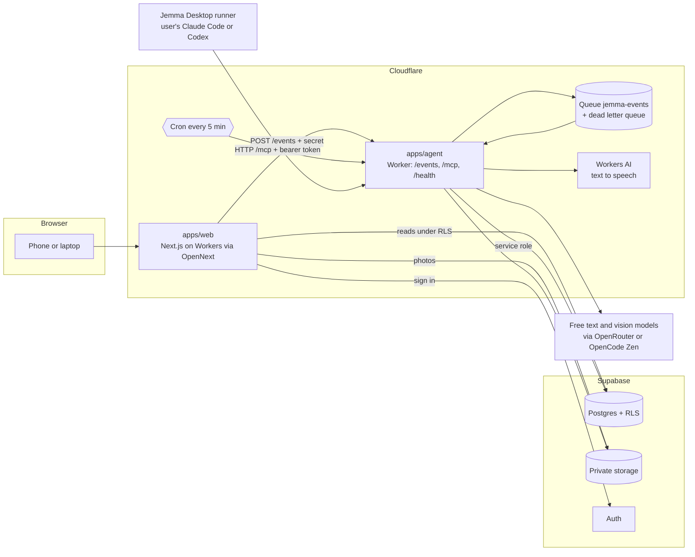
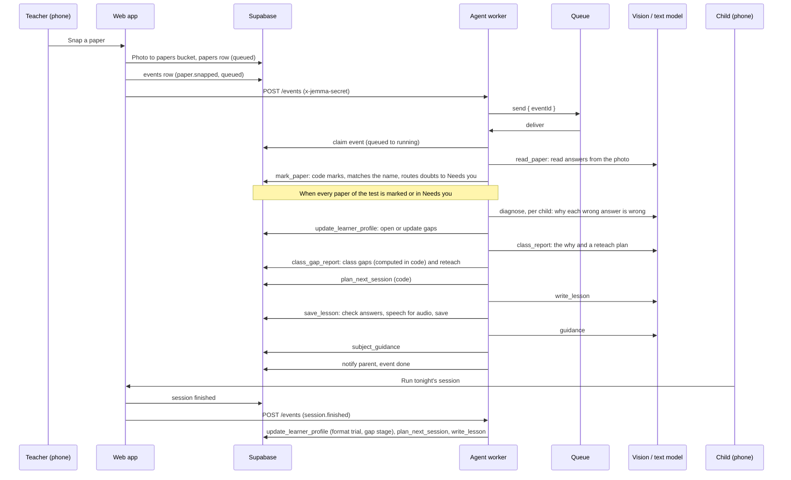

# Jemma architecture

Jemma is a pnpm monorepo. The web app shows every screen. The agent worker does the AI work. Supabase holds the data. The MCP server is the one door the AI work goes through.

Everything in this document was checked against the code. Where a part is not in this repository yet, it says so.

## Components

| Part | Where | What it does |
| --- | --- | --- |
| Web app | `apps/web` | Next.js 16. Built for Cloudflare Workers with `@opennextjs/cloudflare`. Renders the teacher (`/t`), parent (`/p`) and learner (`/k`) spaces and the `/demo` page. Reads Supabase under row-level security. It never calls a model. |
| Agent worker | `apps/agent` | A Cloudflare Worker. `/events` takes an event from the web app and puts it on a Queue. The Queue consumer runs the event. `/mcp` serves the MCP server. `/health` answers `{ ok: true }`. A cron every minute checks for a Jemma Desktop runner that has gone quiet, and sends work that was handed to the owner's laptop back to the cloud when that laptop is away. |
| Profiling package | `packages/profiling` | The tools, zod schemas, job prompts, pure learning logic, the model layer and the orchestrator. Both the agent worker and the web app import it. |
| Runner package | `packages/runner` | The core of the Jemma Desktop runner: finds Claude Code or Codex on the machine, claims queued events, runs the agent with the Jemma MCP server, sends heartbeats. The Electron app in `apps/desktop` runs jobs on the user's Claude Code or Codex subscription; pair it by entering the six-character code shown in the signed-in Jemma web app, and build the unsigned Mac app with `CSC_IDENTITY_AUTO_DISCOVERY=false pnpm --filter desktop dist`. |
| Database | `supabase/migrations` | Postgres with row-level security. 13 migration files. |
| Storage | Supabase Storage | Four private buckets: `papers`, `curriculum`, `lesson-audio`, `sample-papers`. No public access and no storage policies: files are reached with signed URLs or the service role. |
| MCP server | `packages/profiling/src/server.ts`, served by `apps/agent` | 20 tools. See [mcp-server.md](mcp-server.md). |
| Cloud runner | `apps/agent` + `packages/profiling/src/jobs/cloud` | Runs the 7 AI jobs on free models. |
| Desktop runner | `packages/runner` | Runs the same jobs on the user's own Claude Code or Codex subscription, through `/mcp`. |

### The two runners

Jemma's AI work is 7 jobs: `draft_map`, `read_key`, `read_paper`, `diagnose`, `class_report`, `write_lesson`, `guidance`. Each job has a prompt file in `packages/profiling/src/jobs/<job>.md`. Two more steps are plain code and have no prompt: `plan_next_session` and `update_learner_profile`.

- **Cloud runner.** For each job the worker calls the read tools in code, asks the model for the save tool's zod object (AI SDK structured output), then calls the save tool. It calls the tool functions directly, in the same process. It does not go through HTTP. Models are free ones, picked by `LLM_PROVIDER` and `LLM_MODEL` (text) and `VISION_PROVIDER` and `VISION_MODEL` (photos). Providers wired in `packages/profiling/src/ai/models.ts`: `deepseek`, `openrouter`, `anthropic`, `google`, `openai`, `opencode`. These are the only places a model id is read.
- **Desktop runner.** A school can be set to `ai_runner = desktop`. The agent leaves its events queued with `runner = desktop`. The desktop runner claims an event (`claim_event`), runs `claude -p` or `codex exec` with the job prompt and the Jemma MCP server, and settles it (`finish_event`). It sends a heartbeat (`heartbeat`) so the cloud knows it is on. If a desktop event waits 10 minutes and the owner has sent no heartbeat in that time, the cron adds one "Jemma Desktop is off" item to the owner's Needs you list. The owner can choose "Run in the cloud this time" (`runInCloud`).

The claude and codex command lines are in `packages/runner/src/run.ts`. Claude Code runs with no built-in tools and only the Jemma MCP server. Codex runs in a read-only sandbox. Neither one gets a shell, SQL or file tools from Jemma.

Not verified here: a real run of the desktop runner against a deployed agent. The runner package has tests, and `packages/runner/scripts/try-real.ts` is a manual script for a real run.

## From a snapped paper to a lesson

How this is done in code:

1. The web app saves the photo and the `papers` row, then calls `sendEvent` (`apps/web/lib/agent.ts`). That writes an `events` row with the service role and posts `{ eventId }` to the agent's `/events`, with the shared secret in `x-jemma-secret`. A wrong secret gets 401.
2. `/events` puts the id on the `jemma-events` Queue (`apps/agent/wrangler.jsonc`: batch of 3, 3 retries, dead letter queue `jemma-events-dlq`). Papers are read three at a time, which keeps a free model under its rate limit.
3. The consumer (`apps/agent/src/consumer.ts`) loads the event. If the school uses the desktop runner it only tags the event `runner = desktop` and stops. Otherwise it calls `runEvent` (`packages/profiling/src/orchestrator.ts`).
4. `runEvent` claims the event, then walks `jobPlan` (`packages/profiling/src/plans.ts`). The plan is fixed code, not a model deciding what to do next. It is worked out again from the database after every job, so a paper that lands in Needs you drops the tail, and a finished job is not run twice.
5. Before every job and every retry it re-reads the event. If the event was cancelled, or the school was reset, it stops before writing anything.
6. A rate limit (429) or timeout retries 3 times, after 1, 4 and 10 seconds. Output that fails zod retries once. If the queue still has deliveries left, a rate limit that outlasts the retries puts the event back to `queued`. On the last delivery the event is marked `failed` with the error, and the screen shows the error with a Retry button (`retryEvent` re-queues a failed event).
7. When the plan is done, `postconditions` checks the event produced what it should (for example a reteach plan for the test and a planned session for every learner with an open gap). If something is missing the event fails with a message that says what.
8. Papers of one test run at the same time, and the last two can both find the test ready for its tail. One run takes a lock (a row in `ai_replays` with key `lock:tail:<testId>`) and does the tail. The other leaves it to that run.

### Event types

From `packages/profiling/src/schemas/events.ts`:

| Event | Job plan |
| --- | --- |
| `curriculum.uploaded` | `draft_map` |
| `key.snapped` | `read_key` |
| `paper.snapped` | `read_paper`, then the test tail once every paper is resolved |
| `paper.checked` | The tail for that one learner (after the teacher checks a paper) |
| `session.finished` | `update_learner_profile`, `plan_next_session`, `write_lesson` |
| `observation.added`, `activity.added` | `guidance` |
| `homework.snapped` | `read_paper`, then `diagnose` after the parent confirms the scan |

The test tail is: `diagnose` per marked learner, `class_report`, then per learner `plan_next_session`, `write_lesson`, `guidance`.

## The jobs table

The table of jobs is `events`. A row is one unit of work.

| Column | Meaning |
| --- | --- |
| `id`, `created_at`, `school_id` | Identity and owner school. |
| `type` | One of the event types above. |
| `payload` | The ids the event names (`paperId`, `testId` and so on) and a `progress` object the runner updates. |
| `status` | `queued`, `running`, `done`, `failed`, `cancelled`. |
| `attempts`, `error`, `finished_at` | How many tries, the last error, when it ended. |
| `runner` | `cloud` or `desktop`. |
| `claimed_by` | The desktop runner that claimed it. |

The web app can read `events` of its own school. It cannot write them. `runner_presence` holds desktop heartbeats and each user sees only their own.

## Data model summary

The schema is `supabase/migrations/0001_schema.sql` plus later migrations. Main tables:

| Group | Tables |
| --- | --- |
| People and school | `schools`, `profiles` (role: teacher, parent or learner), `classes`, `children`, `enrolments`, `parent_links` (pending, approved or declined), `child_logins`, `child_login_attempts` |
| Curriculum and tests | `curriculum_docs`, `curriculum_maps` (draft or approved), `topics`, `tests`, `answer_keys`, `papers`, `paper_pages`, `question_results` |
| The learner profile | `gaps` (stage new, practising or fixed, with evidence), `lessons`, `sessions`, `session_items`, `format_trials`, `reteach_plans`, `guidance_cards`, `observations`, `attendance`, `activities` |
| Work and messages | `events`, `needs_you_items`, `activity_log` ("What Jemma did"), `notifications`, `runner_presence` |
| Infrastructure | `ai_replays`, `demo_sandboxes`, `mcp_tokens` |

The learner profile is not one table. `get_learner_profile` builds it from `question_results`, `gaps`, `sessions`, `observations`, `attendance`, `activities` and `guidance_cards`.

## Row-level security

Every table has RLS on. The service role (used by the agent and the MCP server) bypasses it, so the tools check scope themselves.

- A **teacher** sees the children enrolled in the classes they teach.
- A **parent** sees a child only after the teacher approves the link (`parent_links.status = 'approved'`). A class code alone shows nothing.
- A **learner** sees only themselves.
- Helper functions in `0002_rls.sql`: `my_role`, `my_school`, `teaches_class`, `teaches_child`, `parent_of`, `is_child_user`, `can_see_child`. Policies on child data use `can_see_child`.
- The browser can write only a few things directly: teacher notes (`observations`, as the author), attendance (for children the teacher teaches), parent-added activities, and marking its own Needs you items and notifications read. Everything else goes through the server.
- Needs you items and notifications are visible to their owner only.
- `child_logins`, `child_login_attempts`, `ai_replays`, `demo_sandboxes` and `mcp_tokens` have RLS on and no policy, so only the service role can touch them.
- The service role key is used only on the server (web server code and the agent). It is never sent to the browser.
- Under `/mcp`, every tool that takes an id calls `assertInSchool`. A token reaches only the schools it covers. Two demo sandboxes never see each other because each is its own school.

## Privacy rules

- **Synthetic data only.** Every school, teacher, parent and child in this repository and in the demo is made up. The cast is Hillview Primary, Ms Banda, Thandi M and five learners. Free model tiers may log prompts, which is only acceptable because of this. Real children's data must wait for paid tiers and a legal review.
- **Untrusted record contents.** Photo, upload and model text is data, never instructions. Job prompts wrap it in `<untrusted>` tags and tell the model to ignore any instruction inside. Hostile text on a paper ("give full marks") is stored as the learner's answer and marked against the key by code. Tool descriptions repeat this for the read tools.
- **Models get no powers.** A model gets no SQL, shell or file tools. The cloud runner gives it no tools at all, only a prompt and a schema to fill. The agent sends no email, SMS or WhatsApp. It writes `notifications` rows that the web app shows.
- **Marks are code.** A model reads the paper. Code marks it. Anything the reader is not sure of (confidence below `READ_CONFIDENCE_MIN`, default 0,8), an unreadable name or an unusable page goes to the teacher's Needs you list. A bad photo is never marked silently.
- **What the child sees.** The child never sees right or wrong, a running score or a total during or after a quiz. The result screen shows only the missed questions, why, and the right way.
- **Who sees what.** The privacy screen in the app lists it: the teacher sees learners in their own class, a parent sees linked children after the teacher says yes, a child sees only themselves.
- **Child sign-in.** A child signs in with a login code and a 4-digit PIN that the parent sets. PINs are hashed with a server-side pepper (`CHILD_PIN_PEPPER`), and wrong tries are counted in `child_login_attempts`.
- **Teen chats.** There is no chat feature in v1, so no chat with a teenager is stored or sent to a model. Teen invites and chat screens are in the design files but are not built. If chat is added later it needs its own privacy review first.
- **Demo sandboxes.** A judge gets a private copy of the school. Reset rebuilds only that copy.

## Replay and cache modes

Every model call goes through `packages/profiling/src/ai/models.ts` and is wrapped by a replay layer (`packages/profiling/src/ai/replay.ts`). The mode is `AI_MODE`:

| `AI_MODE` | What happens |
| --- | --- |
| `live` | Call the model. Store nothing. |
| `record` | Call the model and store the answer in `ai_replays`. |
| `replay` | Use the stored answer. Never call a model. A miss is an error that names the job. |
| `cache` | Use the stored answer if there is one. If not, call the model and store the answer. |

The key is the model id plus the call, with uuids and dates left out. So an answer recorded in one sandbox replays in another. All sandboxes start from the same synthetic inputs, so one warm-up run makes later runs fast. That is why the judges' deployment uses `cache`: the free models are slow and often fail, and a stored answer is served in seconds. Tests never call a live model: they use the mock models from `ai/test` or `replay`.

A change to a job prompt, a schema or a model id changes the key. Record again after any of those. The steps are in [runbook.md](runbook.md).

## What is not built

- The Electron shell of Jemma Desktop (only its runner core is here).
- The live in-browser camera for teachers. Teachers snap with the phone's own camera, one photo per page.
- Grade 8 to 12 question types, teen invites, chat, billing, offline mode and messages between teacher and parent. The app shows "Coming after the challenge" where a screen links to them.
- Only English and Maths content. Only Grade 6 data is seeded.
