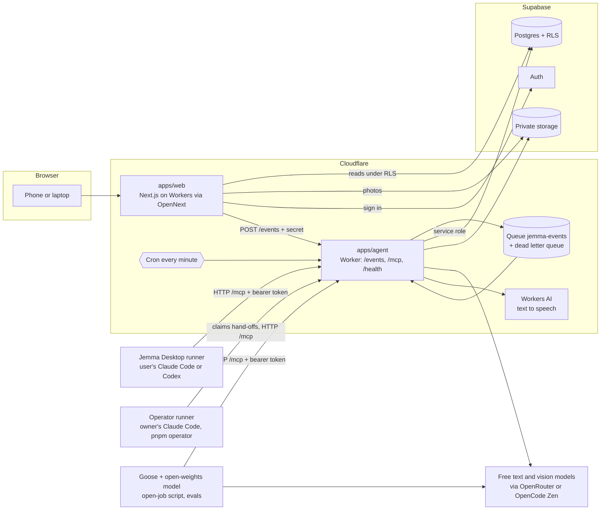
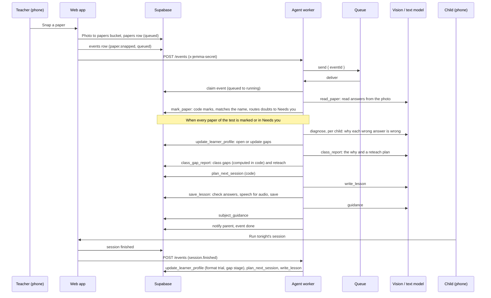

# Jemma architecture

Jemma is a pnpm monorepo. The web app shows every screen. The agent worker does the AI work. Supabase holds the data. The MCP server is the one door the AI work goes through.

Everything in this document was checked against the code. Where a part is not in this repository yet, or was never run, it says so. The one-page version is [ARCHITECTURE.md](../ARCHITECTURE.md).

## Components

| Part | Where | What it does |
| --- | --- | --- |
| Web app | `apps/web` | Next.js 16. Built for Cloudflare Workers with `@opennextjs/cloudflare`. Renders the teacher (`/t`), parent (`/p`) and learner (`/k`) spaces and the `/demo` page. Reads Supabase under row-level security. It never calls a model. |
| Agent worker | `apps/agent` | A Cloudflare Worker. `/events` takes an event from the web app and puts it on a Queue. The Queue consumer runs the event. `/mcp` serves the MCP server. `/health` answers `{ ok: true }`. A cron every minute checks for a Jemma Desktop runner that has gone quiet, and sends work that was handed to the owner's laptop back to the cloud when that laptop is away. |
| Profiling package | `packages/profiling` | The tools, zod schemas, job prompts, pure learning logic, the model layer and the orchestrator. Both the agent worker and the web app import it. |
| Runner package | `packages/runner` | The core of the Jemma Desktop runner: finds Claude Code or Codex on the machine, claims queued events, runs the agent with the Jemma MCP server, sends heartbeats. The Electron app in `apps/desktop` runs jobs on the user's Claude Code or Codex subscription; pair it by entering the six-character code shown in the signed-in Jemma web app, and build the unsigned Mac app with `CSC_IDENTITY_AUTO_DISCOVERY=false pnpm --filter desktop dist`. |
| Database | `supabase/migrations` | Postgres with row-level security. 23 migration files. |
| Storage | Supabase Storage | Five private buckets: `papers`, `curriculum`, `lesson-audio`, `sample-papers`, `records` (the files of past results a teacher brings in). No public access and no storage policies: files are reached with signed URLs or the service role. |
| MCP server | `packages/profiling/src/server.ts`, served by `apps/agent` | 25 tools. See [mcp-server.md](mcp-server.md). |
| Cloud runner | `apps/agent` + `packages/profiling/src/jobs/cloud` | Runs the 9 AI jobs on free models. |
| Desktop runner | `packages/runner` | Runs the same jobs on the user's own Claude Code or Codex subscription, through `/mcp`. |
| Open runner | `packages/runner/src/goose.ts` | Runs a job with goose (open source) on a free open-weights model, through `/mcp`, plus one borrowed MCP server. |
| Operator runner | `packages/runner/src/operator.ts` | The owner's laptop does the hosted app's AI work with the Claude Code (or Codex) signed in on it, or with goose (`pnpm operator`). |

### The runners

Jemma has 9 AI jobs: `draft_map`, `read_key`, `read_paper`, `diagnose`, `class_report`, `write_lesson`, `guidance`, `long_view`, `map_records`. Each job has a prompt file in `packages/profiling/src/jobs/<job>.md`. Two more steps are plain code and have no prompt: `plan_next_session` and `update_learner_profile`. Four runners can do a job. All of them end in the same save tools.

- **Cloud runner.** For each job the worker calls the read tools in code, asks the model for the save tool's zod object (AI SDK structured output), then calls the save tool. It calls the tool functions directly, in the same process. It does not go through HTTP. Models are free ones, picked by `LLM_PROVIDER` and `LLM_MODEL` (text) and `VISION_PROVIDER` and `VISION_MODEL` (photos), with `LLM_MODEL_FALLBACKS` and `VISION_MODEL_FALLBACKS` tried in order. Providers wired in `packages/profiling/src/ai/models.ts`: `deepseek`, `openrouter`, `anthropic`, `google`, `openai`, `opencode`. For the cloud runner these are the only places a model id is read.
- **Desktop runner.** A school can be set to `ai_runner = desktop`. The agent leaves its events queued with `runner = desktop`. The desktop runner claims an event (`claim_event`), runs `claude -p` or `codex exec` with the job prompt and the Jemma MCP server, and settles it (`finish_event`). It sends a heartbeat (`heartbeat`) so the cloud knows it is on. If a desktop event waits 10 minutes and the owner has sent no heartbeat in that time, the cron adds one "Jemma Desktop is off" item to the owner's Needs you list. The owner can choose "Run in the cloud this time" (`runInCloud`).
- **Open runner (goose).** `packages/runner/src/goose.ts` and the goose branch of `runJob` in `run.ts`. Goose (open source, Apache-2.0) drives a free open-weights model on OpenRouter and is given two MCP servers: Jemma's own, with a bearer token, and one borrowed, the official filesystem server (`@modelcontextprotocol/server-filesystem`, pinned to 2.2.0, started with `--confine-roots` so it can see only the reports folder). The recipe file is written with mode 0600 and the token is never in a command line. The models are tried in order, each once: `JEMMA_OPEN_MODEL` (default `nvidia/nemotron-3.5-super-vl:free`), then `JEMMA_OPEN_MODEL_FALLBACKS` (default `nvidia/nemotron-3.5-lightning:free`, `nvidia/nemotron-3-ultra-550b-a55b:free`, `google/gemma-4-31b-it:free`). A model is replaced only when its run failed and no Jemma save tool had succeeded, so nothing is saved twice. A run has at most 20 turns and the whole job has one 10 minute limit. Goose runs with its own empty config folder and the keychain switched off. For `class_report` and `guidance` the prompt also asks for a Markdown copy of what was saved, written to the reports folder (`JEMMA_REPORTS_DIR`, default `<home>/Jemma/reports`). After a run the runner sends the calls to the borrowed server, and the model's tokens and cost, to the tool log with `log_external_calls`. Goose is started by the open-job script (`scripts/proof/run-open-job.ts`) and by `pnpm evals`. The Jemma Desktop app does not offer it. The operator runner can also start goose (`JEMMA_RUNNER_AGENT=goose pnpm operator`): its script keeps `OPENROUTER_API_KEY` for goose only, and removes it and every other provider key for Claude Code and Codex. It was run live on a local agent worker on 11 November: 12 agent runs, all done, seven of the eight AI job kinds ([goose operator proof](proof/operator-goose-2026-11-11.md)).
- **Operator runner.** With `AI_ROUTE=operator` on the agent, each AI job first tries the recorded answers (replay). On a miss, when an operator has been seen in the last 90 seconds (it beats every 30 seconds), the event is handed over: `runner = desktop`, `payload.route = operator` and the stack's `route_tag`. The operator (`pnpm operator`, `packages/runner/src/operator.ts`) claims it (`claim_operator_event`, migration 0017), mints a one-time token for that school, runs each AI job as one Claude Code run (or Codex or goose, `JEMMA_RUNNER_AGENT`) through `/mcp`, runs the two code steps in its own process, and settles the event (`finish_operator_event`). With no operator online, the agent's own model does the job as before. The cron, every minute, sends events handed to a laptop that has gone quiet back to the cloud (`checkOperatorTimeouts`, `route = cloud_live`, never handed over again). An operator never takes the events of a school set to `ai_runner = desktop`, and `draft_map` is never handed over, because Claude Code cannot read a PDF that comes back through MCP. The operator route is off on the hosted demo, which is a setting of the deployed agent that this repository does not record.

The claude and codex command lines are in `packages/runner/src/run.ts`. Claude Code runs with no built-in tools and only the Jemma MCP server. Codex runs in a read-only sandbox. Neither one gets a shell, SQL or file tools from Jemma. Goose gets the one borrowed file server and nothing else.

Not verified here: a real run of the desktop runner against a deployed agent. The runner package has tests, and `packages/runner/scripts/try-real.ts` is a manual script for a real run. The operator path was proven on a local agent worker, not on the deployed one ([operator proof](proof/operator-path-2026-11-10.md)), with Claude Code, and again with goose and the free open-weights models ([goose operator proof](proof/operator-goose-2026-11-11.md)). Neither was run as the whole demo path in one run. The goose path was proven on `class_report` live and then on all 11 eval tasks ([open runner proof](proof/open-runner-2026-11-10.md), [EVALS.md](../EVALS.md)).

## From a snapped paper to a lesson

How this is done in code:

1. The web app saves the photo and the `papers` row, then calls `sendEvent` (`apps/web/lib/agent.ts`). That writes an `events` row with the service role and posts `{ eventId }` to the agent's `/events`, with the shared secret in `x-jemma-secret`. A wrong secret gets 401.
2. `/events` puts the id on the `jemma-events` Queue (`apps/agent/wrangler.jsonc`: batch of 3, 3 retries, dead letter queue `jemma-events-dlq`). Papers are read three at a time, which keeps a free model under its rate limit.
3. The consumer (`apps/agent/src/consumer.ts`) loads the event. If the school uses the desktop runner it only tags the event `runner = desktop` and stops. An event already handed over to an operator is left alone. Otherwise it calls `runEvent` (`packages/profiling/src/orchestrator.ts`), with the operator route on when `AI_ROUTE=operator`.
4. `runEvent` claims the event, then walks `jobPlan` (`packages/profiling/src/plans.ts`). The plan is fixed code, not a model deciding what to do next. It is worked out again from the database after every job, so a paper that lands in Needs you drops the tail, and a finished job is not run twice.
5. Before every job and every retry it re-reads the event. If the event was cancelled, or the school was reset, it stops before writing anything.
6. A rate limit (429) or timeout retries 3 times, after 1, 4 and 10 seconds. Output that fails zod retries once. If the queue still has deliveries left, a rate limit that outlasts the retries puts the event back to `queued`. On the last delivery the event is marked `failed` with the error, and the screen shows the error with a Retry button (`retryEvent` re-queues a failed event).
7. When the plan is done, `postconditions` checks the event produced what it should (for example a reteach plan for the test and a planned session for every learner with an open gap). If something is missing the event fails with a message that says what.
8. Papers of one test run at the same time, and the last two can both find the test ready for its tail. One run takes a lock (a row in `ai_replays` with key `lock:tail:<testId>`) and does the tail. The other leaves it to that run.

### Event types

From `packages/profiling/src/schemas/events.ts`:

| Event | Job plan |
| --- | --- |
| `curriculum.uploaded` | `draft_map` |
| `key.snapped` | `read_key` |
| `paper.snapped` | `read_paper`, then the test tail once every paper is resolved |
| `paper.checked` | The tail for that one learner (after the teacher checks a paper) |
| `session.finished` | `update_learner_profile`, `plan_next_session`, `write_lesson` |
| `observation.added`, `activity.added` | `guidance` |
| `homework.snapped` | `read_paper`, then `diagnose` after the parent confirms the scan |
| `long_view.requested` | `long_view` for one learner (asked for when the teacher opens an empty Long view, taps Update, or saves a note) |
| `test.shared` | Per learner with a marked paper: `plan_next_session`, `write_lesson`, `guidance` (after the teacher taps Share with parents) |
| `records.uploaded` | `map_records` for one file of past results (a teacher uploads a .csv file or pastes a table) |

The test tail is: `diagnose` per marked learner, `class_report`, then per learner `plan_next_session`, `write_lesson`, `guidance`. While a test is held (every test made in the app starts held, see Gates below) the tail stops after `diagnose` and `class_report`, and `postconditions` ask for planned sessions only once the test is shared. `test.shared` does the rest and takes the same tail lock.

## The jobs table

The table of jobs is `events`. A row is one unit of work.

| Column | Meaning |
| --- | --- |
| `id`, `created_at`, `school_id` | Identity and owner school. |
| `type` | One of the event types above. |
| `payload` | The ids the event names (`paperId`, `testId` and so on) and a `progress` object the runner updates. |
| `status` | `queued`, `running`, `done`, `failed`, `cancelled`. |
| `attempts`, `error`, `finished_at` | How many tries, the last error, when it ended. |
| `runner` | `cloud` or `desktop`. |
| `claimed_by` | The desktop runner that claimed it. |

The web app can read `events` of its own school. It cannot write them. `runner_presence` holds desktop heartbeats and each user sees only their own. `operator_presence` holds the heartbeats of operator runners (service role only).

## Data model summary

The schema is `supabase/migrations/0001_schema.sql` plus later migrations. Main tables:

| Group | Tables |
| --- | --- |
| People and school | `schools`, `profiles` (role: teacher, parent or learner), `classes`, `children`, `enrolments`, `parent_links` (pending, approved or declined), `child_logins`, `child_login_attempts` |
| Curriculum and tests | `curriculum_docs`, `curriculum_maps` (draft or approved), `topics`, `tests`, `answer_keys`, `papers`, `paper_pages`, `question_results` |
| The learner profile | `gaps` (stage new, practising or fixed, with evidence), `lessons`, `sessions`, `session_items`, `format_trials`, `reteach_plans`, `guidance_cards`, `observations`, `attendance`, `activities` |
| The Long view | `learner_records` (past years: quizzes, assignments, projects, notes, attendance by term; each marked piece has a subject; a record brought in keeps its file, row and who added it), `record_imports` (a file of past results, what its columns mean, every row as code read it and the problems found), `long_view_patterns` (what Jemma found, in one subject, with its status: draft, approved, dismissed or discussed) |
| Work and messages | `events`, `needs_you_items`, `activity_log` ("What Jemma did"), `notifications`, `runner_presence`, `operator_presence` |
| The log | `tool_calls` (every tool call), `approvals` (every human decision, with the person's name) |
| Infrastructure | `ai_replays`, `demo_sandboxes`, `mcp_tokens` |

The learner profile is not one table. `get_learner_profile` builds it from `question_results`, `gaps`, `sessions`, `observations`, `attendance`, `activities` and `guidance_cards`. The Long view is built from `learner_records` and the marked answers of this year (`get_learner_history`), and never changes the profile.

## Row-level security

Every table has RLS on. The service role (used by the agent and the MCP server) bypasses it, so the tools check scope themselves.

- A **teacher** sees the children enrolled in the classes they teach.
- A **parent** sees a child only after the teacher approves the link (`parent_links.status = 'approved'`). A class code alone shows nothing.
- A **learner** sees only themselves.
- Helper functions in `0002_rls.sql`: `my_role`, `my_school`, `teaches_class`, `teaches_child`, `parent_of`, `is_child_user`, `can_see_child`. Policies on child data use `can_see_child`.
- The browser can write only a few things directly: teacher notes (`observations`, as the author), attendance (for children the teacher teaches), parent-added activities, and marking its own Needs you items and notifications read. Everything else goes through the server.
- A test that is held (`tests.held`, set by `0018_share_gate.sql`) is hidden from the family: for an approved parent and the learner, `papers`, `question_results`, `gaps` and the child's `activity_log` lines come from a shared test only (helpers `is_family`, `paper_shared`, `gap_shared`, `event_shared`). Homework and papers with no test stay visible. The teacher branch of every policy is unchanged.
- The Long view (`0019_long_view.sql`): the class teacher reads `learner_records` and every row of `long_view_patterns`. An approved parent reads a pattern only when its status is `discussed`. A learner never reads either table.
- The tool log (`0016_tool_calls_and_approvals.sql`): `tool_calls` is read by the teachers of the school only, `approvals` by the teachers of the school and by the person who gave the approval. Nothing writes to them but the service role.
- Needs you items and notifications are visible to their owner only.
- `child_logins`, `child_login_attempts`, `ai_replays`, `demo_sandboxes`, `mcp_tokens` and `operator_presence` have RLS on and no policy, so only the service role can touch them.
- The service role key is used only on the server (web server code and the agent). It is never sent to the browser.
- Under `/mcp`, every tool that takes an id calls `assertInSchool`. A token reaches only the schools it covers. Two demo sandboxes never see each other because each is its own school.

## Privacy rules

- **Synthetic data only.** Every school, teacher, parent and child in this repository and in the demo is made up. The cast is Hillview Primary, Ms Banda, Thandi M and five learners. Free model tiers may log prompts, which is only acceptable because of this. Real children's data must wait for paid tiers and a legal review.
- **Untrusted record contents.** Photo, upload and model text is data, never instructions. Job prompts wrap it in `<untrusted>` tags and tell the model to ignore any instruction inside. Hostile text on a paper ("give full marks") is stored as the learner's answer and marked against the key by code. Tool descriptions repeat this for the read tools.
- **Models get no powers.** A model gets no SQL and no shell. The cloud runner gives it no tools at all, only a prompt and a schema to fill. Goose gets one borrowed file server that can see one reports folder (`--confine-roots`). The `file-server-confined` eval asks the model for a file outside that folder and for the recipe file that holds the token. In all 3 runs the real recipe file was refused, and in the run where the model tried to write outside the folder, that was refused too. The agent sends no email, SMS or WhatsApp. It writes `notifications` rows that the web app shows.
- **Marks are code.** A model reads the paper. Code marks it. Anything the reader is not sure of (confidence below `READ_CONFIDENCE_MIN`, default 0,8), an unreadable name or an unusable page goes to the teacher's Needs you list. A bad photo is never marked silently.
- **What the child sees.** The child never sees right or wrong, a running score or a total during or after a quiz. The result screen shows only the missed questions, why, and the right way.
- **Who sees what.** The privacy screen in the app lists it: the teacher sees learners in their own class, a parent sees linked children after the teacher says yes, a child sees only themselves.
- **Child sign-in.** A child signs in with a login code and a 4-digit PIN that the parent sets. PINs are hashed with a server-side pepper (`CHILD_PIN_PEPPER`), and wrong tries are counted in `child_login_attempts`.
- **Teen chats.** There is no chat feature in v1, so no chat with a teenager is stored or sent to a model. Teen invites and chat screens are in the design files but are not built. If chat is added later it needs its own privacy review first.
- **Demo sandboxes.** A judge gets a private copy of the school. Reset rebuilds only that copy.

## Gates

What Jemma may not do on its own. Each gate is a person tapping, and the log screen ("The full log", `/t/<classId>/log`) lists every approval with the person's name.

| Jemma may not, on its own | Who must approve | Where the name is kept |
| --- | --- | --- |
| Use a topic map | The teacher: Approve map | `approvals` (`topic_map`) |
| Mark against an answer key | The teacher: Approve key | `approvals` (`answer_key`) |
| Count a mark it is unsure of | The teacher: check and confirm the paper in Needs you | `approvals` (`mark`, `paper`), `question_results.changed_by` |
| Link a guardian to a child | The teacher: say yes to the request | `approvals` (`guardian_link`), `parent_links.decided_at` |
| Show a test to a parent or learner, or plan a lesson from it | The teacher: Share with parents, once per test | `approvals` (`share_results`), `tests.shared_by`, `tests.shared_at` |
| Treat a Long view pattern as checked | The teacher: Looks right (Not yet sets it aside) | `approvals` (`long_view_pattern`), `long_view_patterns.approved_by_name`, `approved_at` |
| Show a Long view pattern to a guardian | The teacher: We have talked, after the talk, and only when a guardian link is approved | `approvals` (`long_view_talk`), `long_view_patterns.discussed_by_name`, `discussed_at` |
| Add a file of past results to learners' records | The teacher of the class: Add to records, after checking the rows with a problem | `approvals` (`record_import`), `record_imports.approved_by_name`, `approved_at`, and `learner_records.added_by_name` on every record |

Two more decisions are logged as approvals but are confirmations, not gates: marking a reteach as taught (`reteach`) and confirming a homework scan (`homework_scan`).

## The Long view

A pattern is a strength or a struggle that held for 3 terms or more. Code finds it, in `packages/profiling/src/logic/long-view.ts`. The model only words it.

1. Past years sit in `learner_records`, this year's marked answers in `question_results`, both grouped by subject and then by the topic's `family` (this year's answers take their subject and grade from the class of the test). Terms are calendar quarters. A family needs 3 marks in a term for the term to count.
2. A strength is 80% or more, a struggle is below 50%, and a pattern needs 3 terms in a row. It may be followed by up to 2 newer terms that did not continue it. They are kept next to it, with their sources. Terms with no data are skipped and named, never guessed. Marks that were unclear never count.
3. `long_view.requested` runs the `long_view` job. The model reads `get_learner_history` and sends `save_long_view` a key, a subject, a title and a statement for each pattern code found, and for nothing else. The tool attaches the terms and the evidence itself, and drops a pattern that matches no record, uses a banned word (a label, a ranking or comparison, career talk) or is too long. On the cloud runner, a learner with no pattern gets an empty list without a model call.
4. A saved pattern is a draft and the teacher gets one Needs you item (`review_long_view`). The teacher can open each source, taps Looks right (or Not yet), and after talking to the guardian taps We have talked. Only then is it shared, the approved guardians are told, and `long_view_patterns.status` is `discussed`. The learner never sees the Long view.
5. A new note, the Update button, or opening a Long view that is empty asks for a new update. A pattern the records stop showing is deleted if it is a draft, and switched off (`active = false`) if the teacher had touched it.

## Bringing past records in

A real class cannot show a pattern until its past results are in the Long view. A teacher of a class opens the Learners tab and taps Add past records, then uploads a .csv file (up to 1 MB and 2,000 rows), pastes a table, or types One result.

1. The file goes to the private `records` bucket and a `record_imports` row (`drafting`) is made. The web app sends `records.uploaded`.
2. The `map_records` job shows the model only the header row, the first 8 rows, the file name, the class's subject and grade, the first names of the class and the strands a topic can belong to (the families of the class's approved topic map, else the strands this app knows for the subject, else none). The model says which column is the learner, the mark, the total (or percent), the date or term, and so on, what is true of every row when a column is missing, and the strand of each topic it can see. The file is wrapped in `<untrusted>` tags: it is data, never instructions.
3. `save_record_mapping` checks the answer against the header, then code reads every row (`packages/profiling/src/logic/record-import.ts`): it matches learners by first name inside the class (case and accents ignored, a surname letter breaks a tie), reads marks (`14/20`, `70%`, `14 out of 20`, a decimal comma), works out the term from the date (for South Africa January to March is term 1, and the review screen says so), and flags what is wrong: an unknown learner, two learners, a mark above the total, no term and no date, a topic it is unsure of, a mark it cannot read, a mark with no total, and a row that repeats a record the learner already has or an earlier row. The rows and the problems are kept on the import, the status is `ready`, and the teacher gets one Needs you item. Nothing is written to `learner_records` yet.
4. On the review screen (`/t/<classId>/learners/records/<importId>`) the teacher sees the mapping in plain words, the counts, the problem rows first (pick the learner, change the strand, skip the row, or keep a repeat) and a sample of the good rows. Rows with a problem still open are left out.
5. Add to records is the gate: `approveImport` saves the teacher's decision in `approvals` (`record_import`, with their name) and stamps the import with it. Then `import_learner_records` writes the records, and refuses unless that approval is there from the teacher of the class. Each record keeps its kind (`quiz`, `assignment`, `project`, `note`, `attendance`), the file (`import_id`), the row (`source_row`) and who added it (`added_by`, `added_by_name`), and its `logged_at` is now, so a late entry shows as late. Discard writes nothing. Nothing reaches a parent or a learner until the teacher talks to the guardian about a pattern, as before.
6. A typed One result writes one record the same way (`add_learner_record`, logged like the other saves, no model) with `added_by` set and no `import_id`.

Where a record came from is told by those columns: `import_id` set is a file, `added_by` set with no `import_id` is a teacher who typed it, both empty is the demo seed. `source` stays the kind of piece, because the pattern finder counts only quizzes, assignments and projects.

## The tool log

Every tool is created with `defineTool` (`packages/profiling/src/tools/context.ts`), which saves one `tool_calls` row for each call, whether it came from a cloud job or through `/mcp`: the school, the event, the server, the tool, who ran it (`cloud`, `mcp` or `runner`), the engine and model when known, the input and output, whether it worked, and the time and duration. A runner reports the calls an agent made to other servers with `log_external_calls`, and one `agent_run` row with tokens and cost. Strings longer than 2000 characters are stored as their length, image data is never stored, and a failure to write the log never changes what a tool returns. Teachers read it on "The full log". The details are in [mcp-server.md](mcp-server.md).

## Replay and cache modes

Every model call goes through `packages/profiling/src/ai/models.ts` and is wrapped by a replay layer (`packages/profiling/src/ai/replay.ts`). The mode is `AI_MODE`:

| `AI_MODE` | What happens |
| --- | --- |
| `live` | Call the model. Store nothing. |
| `record` | Call the model and store the answer in `ai_replays`. |
| `replay` | Use the stored answer. Never call a model. A miss is an error that names the job. |
| `cache` | Use the stored answer if there is one. If not, call the model and store the answer. |

The key is the model id plus the call, with uuids and dates left out. So an answer recorded in one sandbox replays in another. All sandboxes start from the same synthetic inputs, so one warm-up run makes later runs fast. That is why the judges' deployment uses `cache`: the free models are slow and often fail, and a stored answer is served in seconds. Tests never call a live model: they use the mock models from `ai/test` or `replay`.

A change to a job prompt, a schema or a model id changes the key. Record again after any of those. The steps are in [runbook.md](runbook.md).

## What is not built

- Jemma Desktop as a checked product. The Electron app is in `apps/desktop` and wraps the runner, but the Mac app was not run for this submission and is unverified. It does not offer goose.
- The curriculum PDF on a laptop or on goose. `draft_map` is never handed to the operator, and has not been run on goose. Curriculum PDFs are read by the cloud model only.
- The operator route on the hosted demo. It is proven on a local agent worker only.
- The live in-browser camera for teachers. Teachers snap with the phone's own camera, one photo per page.
- Grade 8 to 12 question types, teen invites, chat, billing, offline mode and messages between teacher and parent. The app shows "Coming after the challenge" where a screen links to them.
- Only English and Maths content. Only Grade 6 data is seeded.
